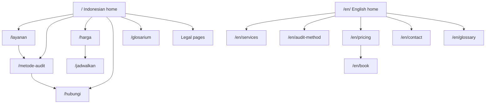
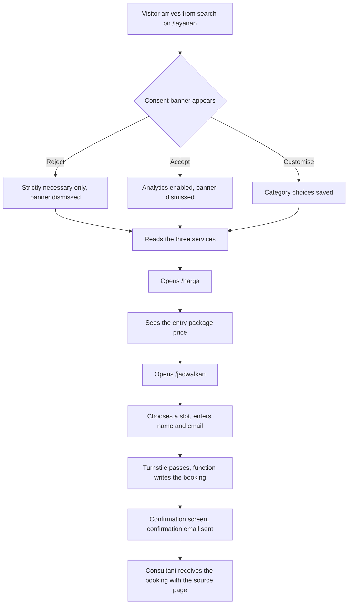
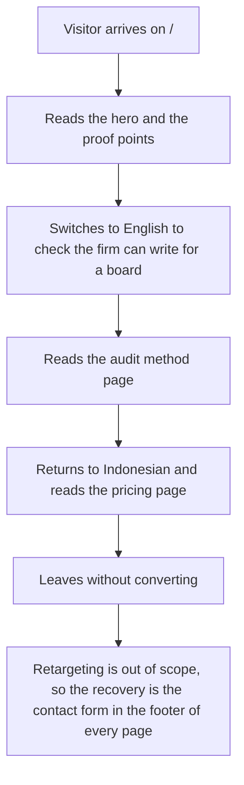
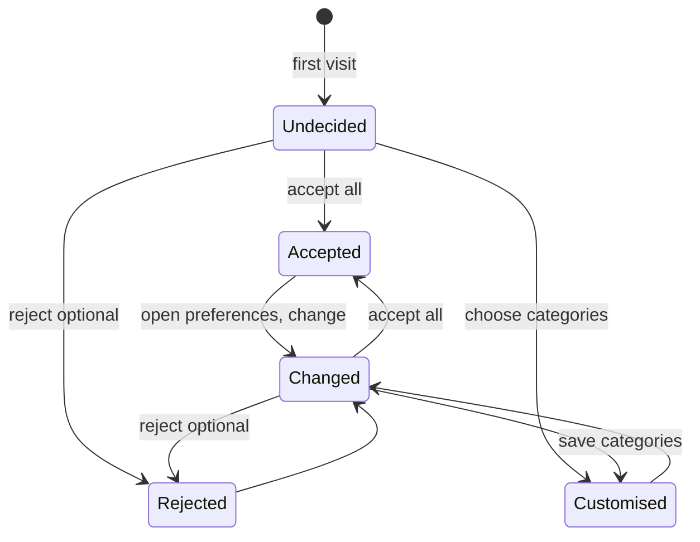
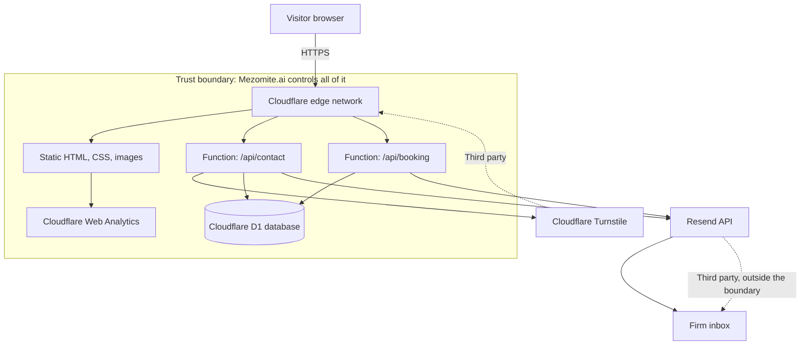
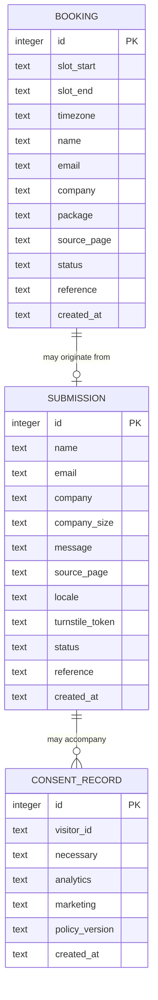
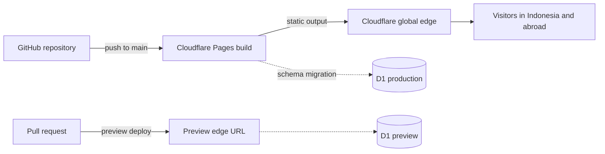
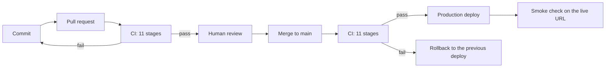

# Mezomite.ai

Consulting, audit, and digitization services for Indonesian businesses, sold through one bilingual website.

| Field | Value |
|---|---|
| Version | 0.1 |
| Date | 2026-10-24 |
| Status | Draft |
| Owner | Mezomite.ai |
| Type | Marketing website |
| Delivery method | Kanban, work-in-progress limit of 2 |
| Delivery method note | One developer, requirements still moving |
| Target launch window | Week 6 from start |
| Currency | IDR (USD shown with a stated rate) |
| Research date | 2026-10-24 |
| Exchange rate used | 1 USD = IDR 18,100 (checked 2026-10-24) |

## Contents

1. TL;DR
2. Context and problem
3. Users
4. Goals, metrics, and non-goals
5. Scope and release plan
6. Features and requirements
7. User flows and information architecture
8. Design system
9. Architecture and tech stack
10. Data model
11. Backend and API
12. Infrastructure and environments
13. Security, privacy, and compliance
14. Testing and quality
15. Development workflow
16. Deployment and shipping plan
17. Analytics, growth, and monetization
18. Roadmap and milestones
19. Costs
20. Risks, open questions, and decisions
21. Appendices

Section 6 holds the scope table and section 7 the features, so the cross-references in the roadmap point at section 7 for feature IDs and at section 6 for priorities.

## TL;DR

Mezomite.ai is a bilingual (Indonesian and English) marketing website that sells consulting, audit, and digitization engagements to Indonesian businesses. It does not host client work. Consultants deliver audit reports offline, so the site's only job is to explain the offer, prove competence, and convert a visitor into a booked discovery call.

The problem it solves is stated in section 3. In one sentence: Indonesian SME owners know their manual processes cost them time and money, but they cannot tell which of the many AI and automation vendors are selling them something useful.

The MVP is five screens in two languages, a contact form that writes to a database, a booking page, and a legal footer. No client portal, no accounts, no dashboard, no payments on the site.

The stack is Astro 7 with static output, hosted on Cloudflare Pages, with a small serverless function for the contact form, Cloudflare Turnstile in front of it, Resend for email notification, and Cloudflare Web Analytics. First year cost is IDR 250,000 for the domain, plus the amortised domain line of IDR 20,833 per month. Every service runs on a free tier. Monthly running cost after launch is IDR 0 on the free path.

Timeline is six weeks on the free path. The design direction is a trust-first, editorial, high-contrast system with one technical flavor, because the buyer is a business owner who is about to pay for advice and needs to believe the firm is competent before reading a word of it.

Three risks dominate. First, the site cannot prove competence without client evidence, and there may be no client evidence yet. Second, Indonesian privacy law takes effect on 16 January 2027, and the contact form and analytics have to be designed for consent from the start. Third, a single developer owns the whole site, so a week of lost time is a week of lost timeline.

The assumptions table in section 6 lists every assumption. The two that would change the plan's shape are in section 21 as open questions.

## Context and problem

### Background

Mezomite.ai is a consulting practice that helps businesses audit, map, and digitize the way they work. The offer has three parts: an audit that finds where time and money leak, a workflow map that shows how work actually moves, and an automation or AI build that removes the repetitive parts. The website is the storefront for that practice.

Indonesia has roughly 64 million UMKM contributing about 61.9 percent of GDP, and government data puts about 30 million of them in some digital ecosystem (checked 2026-10-24, sources in appendix C). Adoption of automation among large Indonesian companies was reported at 35 percent in 2024 by the Ministry of Industry (checked 2026-10-24). The gap between those numbers is the market: a very large base of small businesses that are told to digitize and given no affordable way to find out what that means for them.

The competitive field is crowded with generalist IT consultants and a smaller group of AI-focused boutiques. Research found six comparable sellers in Indonesia and abroad, summarised below. None of them sell the way this site will, which is the point of differentiation in section 5.

### Problem statements

Five problems, each with an ID, the person affected, what happens today, and what it costs.

### P-1

An SME owner in Surabaya runs purchasing, invoicing, and stock updates by hand in spreadsheets and WhatsApp. She knows this is expensive but cannot say which single change would return the most hours. The cost is her own time, which she cannot spend on sales, and a growing error rate in stock records that she only notices when a customer complains.

### P-2

The same owner searches for AI help and finds vendors who all claim to save 30 hours a week. Every vendor sells a tool first and a diagnosis second. The cost of choosing wrong is the project fee plus a quarter of disruption, and the cost of choosing nothing is continuing to lose the hours.

### P-3

A mid-size company director needs an audit before committing budget. He wants a written report he can show the board. Today he has no way to compare firms on method, because most firms publish services and no method. The cost is decision paralysis, which delays the whole budget line.

### P-4

A business that has already bought automation finds it unused after three months, because nobody mapped the process first. The cost is a sunk build fee and a team that now distrusts the idea of automation, which makes the next attempt harder.

### P-5

The consulting firm itself cannot explain its method on a website, because the method is the product. A site that lists services without showing how an audit works invites price comparison instead of trust. The cost is a low conversion rate and a sales cycle carried entirely by conversation.

### Alternatives today

Six comparable sellers were reviewed on 2026-10-24. The table summarises what each does, what it charges, and the gap this project fills.

| Seller | What it does | Price | Strength | Gap this project fills |
|---|---|---|---|---|
| Javan (javan.co.id) | BPM and BPMN consulting, Odoo implementation, process automation. Operating since 2009, reports 332 use cases for 106 clients | Not published, consultation first | Long track record, named client volume, deep BPMN method | No published method for auditing an SME, no English path, no fixed-fee entry point |
| IDStar (idstar.co.id) | Digital transformation consulting, RPA, tax automation, document processing | Not published | Broad service list, enterprise positioning | Enterprise framing prices out an SME buyer, no self-serve entry |
| Eltera (eltera.id) | Digital transformation consulting, maturity assessment, 12 to 36 month roadmap | Not published | Explicit ROI framing and a 3 to 6 month quick-win window | Roadmap spans years, which is too heavy for a small business |
| Bandung TalentSource | RPA packages from free webinar to consulting and build | Package based, not published per item | Six clear package steps from free intro to build | RPA-first, not AI-first, and no published price per package |
| Rama Digital (ramadigital.id) | AI consulting for UMKM, readiness mapping, prioritisation | From Rp 1.5 million diagnostic, Rp 6 million workflow audit, Rp 15 million roadmap | Catalog pricing published before engagement, free 30 minute consult | Prices published but the site does not show the audit method itself |
| AI Consulting Bali | AI strategy, LLM integration, n8n and Make implementation | USD 2,000 to 6,000 for a 2 to 3 week audit | Transparent written proposal, IDR and USD pricing, clear timeline | Bali-focused, serves international and villa clients, English-first |

The pattern across all six is that price is hidden behind a contact form, or the firm is too large to serve an SME at a price an SME will pay. The opportunity is a firm that publishes its method, publishes its entry price, and writes for the owner rather than the IT director.

### Opportunity

When this site exists, an owner can read a page, understand exactly what an audit produces, see the price of the entry package, and book a call. The firm stops competing on claims and starts competing on method, which is the only thing a small firm can win with.

The vision is a consulting firm whose website does the qualifying work, so the first call is with a buyer who already understands the offer. That is worth more to the firm than any amount of traffic.

## Users

Three personas. The buyer and the user are the same person in the SME case, which is why the site is written for owners rather than for technical staff.

### Persona 1: The owner who knows something is wrong

Rina, 42, runs a food processing business in East Java with 35 staff. Revenue is around IDR 8 billion a year. She handles purchasing and approvals herself because nobody else has the authority. She works six days a week and cannot remember the last time she took a holiday.

Her goal is to stop being the bottleneck. Her frustration is that every consultant she has spoken to starts by selling software. She is comfortable with WhatsApp, Google Sheets, and a marketplace dashboard, and not comfortable with anything else. She reads on a mid-range Android phone, mostly on mobile data, sometimes on a shop floor with a poor connection. She needs text that a screen reader could handle if her eyes are tired, and she needs pages that load fast on that connection.

Her job to be done: find out which single change gives me the most hours back, and what it costs, in under ten minutes of reading.

First run scenario: she arrives from a Google search for "jasa audit proses bisnis", lands on the Indonesian home page, scrolls once, and needs to see within three seconds that this firm audits processes and charges a fixed fee.

### Persona 2: The director who needs a defensible decision

Bambang, 51, is operations director at a 200 person logistics company in Jakarta. He has budget authority but needs board approval. He has been burned once by an automation project that was never used.

His goal is a written report he can hand to the board with a price attached to each recommendation. His frustration is that firms will not commit to a fixed fee or a fixed deliverable. He reads on a laptop, often on a train, and he will read the English version because his board materials are in English.

His job to be done: compare two or three firms on method and fixed price, and pick one without a political risk.

First run scenario: he arrives from a referral, opens the English services page, reads the audit method section, and checks that the entry package has a published price and a defined deliverable.

### Persona 3: The ops manager who has to make it work

Sari, 33, is an operations manager at a company that has already bought an audit from Mezomite.ai. She is not a website buyer, but she is a website reader, because the site holds the glossary, the method, and the glossary of terms the consultants use.

Her goal is to align her team with the vocabulary in the audit report. Her frustration is jargon. She needs every term defined once, in plain Indonesian, with an English equivalent because her director uses English.

### Buyer versus user

In the SME segment the owner is both. In the mid-size segment the buyer is the director and the user is the ops team. The site writes for the buyer, because the buyer decides, and keeps a plain-language glossary for the user.

### Jobs to be done

JTBD-1. When I suspect my processes are expensive, help me confirm it in minutes and tell me the price to fix it.

JTBD-2. When I am comparing consultants, show me your method and your fixed fee so I can compare like for like.

JTBD-3. When I have bought an audit, give me the terms and steps so my team and I speak the same language.

## Goals, metrics, and non-goals

### Goals

| ID | Goal | Metric | Target | Measurement | Time frame |
|---|---|---|---|---|---|
| G-1 | A visitor becomes a qualified lead | Discovery call bookings per month | 8 | Form submissions tagged as booked, reviewed weekly | First 3 months after launch |
| G-2 | A visitor understands the offer without help | Contact form conversion rate from the home page | 2.0 percent | Analytics event on form submit divided by home page pageviews | First 3 months after launch |
| G-3 | The site loads for an owner on mobile data | Largest Contentful Paint on a mid-range Android, 4G throttled | Under 2.0 seconds | Lighthouse CI in the build pipeline | At launch and every release |
| G-4 | The Indonesian and English pages are equivalent | Missing translation coverage, measured as translated routes divided by total routes | 100 percent | Build-time check in CI | At launch and every release |
| G-5 | The site survives the privacy law change | Number of personal data collection points without a lawful basis recorded | 0 | Data map review against PP 33/2026 | Before 16 January 2027 |
| G-6 | The firm can publish content without a developer | Content updates shipped per month by a non-developer | 4 | Git commit log review | Month 2 after launch |

### Guardrail metrics

| Metric | Target | Why |
|---|---|---|
| Error rate on the contact form | Under 1 percent of submissions | A lost lead is the most expensive failure this site can have |
| Cumulative Layout Shift | Under 0.05 | Shifted layouts on a phone make the firm look careless |
| Uptime | 99.5 percent measured monthly | A dead contact page is a dead business |
| Lighthouse performance score | 95 or above | The buyer is often on a phone |
| Accessibility audit issues (axe) | 0 serious or critical | Legal exposure and basic competence |
| Time to first content edit after a request | Under 1 business day | Slow content updates erode trust in the firm |

### Non-goals

NG-1. No client portal, no client accounts, no dashboard. Client work is delivered by consultants outside the site.

NG-2. No self-serve product, no subscription signup, no usage-based pricing on the site.

NG-3. No payments taken on the site. Invoices are issued outside it, and payment is by bank transfer or QRIS.

NG-4. No marketing automation, no email sequences, no CRM integration in the MVP. A spreadsheet is enough at eight leads a month.

NG-5. No chat widget, no live chat, no bot. The contact form and a WhatsApp link are the only channels.

NG-6. No case studies with named clients in the MVP, unless a client has agreed in writing. Placeholder case studies would be dishonest and would fail the writing bar.

NG-7. No English-first assumption about literacy. Indonesian is the default language because the SME buyer reads in Indonesian.

NG-8. No mobile app. The site is responsive and that is the whole product surface.

## Scope and release plan

### MoSCoW

Every item carries a feature ID from section 7 so the roadmap in section 19 can cite it.

| ID | Feature | Priority | Reason |
|---|---|---|---|
| F-001 | Bilingual routing, Indonesian default | Must | The SME buyer reads in Indonesian, and language parity is goal G-4 |
| F-002 | Home page in both languages | Must | First impression and the conversion surface |
| F-003 | Services page in both languages | Must | The offer must be readable before a call is booked |
| F-004 | Audit method page in both languages | Must | This is the differentiator and the trust surface |
| F-005 | Pricing page with published entry packages | Must | Competitors hide price, so publishing it wins the comparison |
| F-006 | Contact form with Turnstile and email notification | Must | The only conversion mechanism |
| F-007 | Booking page with a fixed call length and timezone | Must | Reduces the back and forth that kills a small firm's sales time |
| F-008 | Legal pages: privacy policy, terms, cookie policy | Must | Required by law and by app stores for any business with a web presence |
| F-009 | Consent banner with granular choices | Must | Required under PP 33/2026 as described in section 14 |
| F-010 | Analytics with cookieless measurement | Must | Needed to know whether the site works at all |
| F-011 | Content collections for pages and a glossary | Must | G-6 requires a non-developer to publish content |
| F-012 | Case study template with no named clients | Should | Structure ready, filled when a client agrees |
| F-013 | Glossary of consulting terms, both languages | Should | Serves persona 3 and helps search |
| F-014 | Sitemap, robots, structured data, Open Graph | Should | Search visibility from day one |
| F-015 | Automated accessibility and performance checks in CI | Should | Guards G-3 and the guardrail metrics |
| F-016 | News or insight section | Could | Useful for search, but it needs a publishing habit first |
| F-017 | Client evidence page with testimonials | Could | Depends on client consent, so it waits |
| F-018 | A second contact channel, WhatsApp deep link | Could | Useful, but the form is enough for the MVP |
| F-019 | A second language beyond English | Won't for now | No evidence of demand, and translation doubles every content task |
| F-020 | A client portal or login | Won't for now | Explicitly out of scope, see NG-1 |
| F-021 | Online payments or invoicing on the site | Won't for now | Explicitly out of scope, see NG-3 |

### MVP definition

The MVP is a bilingual marketing site that explains the three service lines, publishes the audit method and the entry pricing, and converts a visitor into a booked discovery call through a working contact form, delivered in six weeks with no paid services.

### Release plan

Phase 1, weeks 1 to 2. Foundations: repository, design tokens, bilingual routing, the five core pages as skeletons, CI, and a deployed empty site on a preview domain. Exit criteria: the site builds, both languages resolve, and the pipeline runs the checks.

Phase 2, weeks 3 to 4. Content and conversion: real copy in both languages, the contact form end to end, Turnstile, email notification, the booking page, and the legal pages. Exit criteria: a form submission writes a row, sends an email, and shows a confirmation the user can read.

Phase 3, week 5. Hardening: consent banner, analytics, SEO metadata, structured data, accessibility fixes, performance work, and the content workflow for a non-developer. Exit criteria: axe reports zero serious issues, Lighthouse performance is 95 or above, and a non-developer has shipped a content change.

Phase 4, week 6. Launch: domain and DNS, production deploy, monitoring, a rollback drill, and the first week of watching. Exit criteria: the launch checklist in section 17 is complete.

### Constraints

Budget is zero at launch. The whole plan runs on free tiers, which means accepting their limits: no uptime guarantee, no support channel, and a database that pauses when idle if one is used.

Time is the real constraint. Six weeks assumes one developer working steadily. Every week of interruption pushes the launch by a week.

Skills constraint: the person building this must be able to write Indonesian copy that reads naturally, or the site must be written by someone who can. Machine-translated Indonesian reads as machine-translated, and it would undo the entire trust argument.

Legal constraint: PP 33/2026 takes effect on 16 January 2027. The data map, the consent mechanism, and the retention policy must be designed before launch, not retrofitted.

### Assumptions

These are the defaults the plan runs on. Section 21 lists the two that would change the shape.

| ID | Assumption | Default if wrong |
|---|---|---|
| A-1 | The business sells consulting services and software licences to Indonesian clients | Cost tables change, but nothing structural |
| A-2 | The buyer reads in Indonesian first and English second | Reverse the default locale |
| A-3 | Prices will be published on the site | Keep the pricing page but remove the numbers |
| A-4 | One developer builds the site in six weeks | Extend the timeline or cut F-016 to F-018 |
| A-5 | No client names or case studies are available at launch | Ship F-012 as an empty template, as planned |
| A-6 | The firm has a Google Workspace or similar account for transactional email | Use Resend with a domain the firm controls |
| A-7 | The domain is available in the chosen form | Section 21, OQ-1 |
| A-8 | The firm is registered and can issue invoices | Section 14, and OQ-2 |
| A-9 | Hosting on free tiers is acceptable for a commercial site | Move to the ideal column, which is still cheap |

### Dependencies on third parties

| Service | What it provides | What breaks if it disappears |
|---|---|---|
| Cloudflare Pages | Hosting, CDN, DNS, Web Analytics, Turnstile | The site is offline. This is the single largest dependency and the reason for the static export path in section 10 |
| Resend | Transactional email from the contact form | Leads are lost silently. Mitigated by storing every submission in a database |
| Cloudflare D1 | The submissions database | Form submissions are lost. Mitigated by email notification as a second channel |
| Midtrans | Payment collection, if invoicing is ever added | Nothing in the MVP, payments are out of scope |
| The firm's own domain registrar | The domain | Brand and email deliverability |

## Features and requirements

F-001 through F-011 carry an ID, a priority from section 6, a user story, acceptance criteria in Given-When-Then form, edge cases, states, analytics events, permissions, and an effort estimate. Effort is S for under four hours, M for under two days, L for more than two days. F-012 through F-018 are smaller and are specified as a one line acceptance criterion each.

### F-001 Bilingual routing

Priority: Must. Effort: M.

User story: as a visitor, I want the site to open in my language so that I can read it without hunting for a language switch.

Acceptance criteria:

- Given a request with no locale, when the site loads, then Indonesian content renders at the root path.
- Given an Indonesian page, when I open the language switch, then the equivalent English page loads at the /en/ path.
- Given a page that exists only in Indonesian, when I switch to English, then the page renders in English or shows a not-translated notice, never a broken layout.
- Given a page in both languages, when a crawler reads it, then hreflang tags name both versions and the self-referencing tag.
- Given a browser that has chosen a language before, when I return, then my choice persists.

Edge cases: a URL with an unsupported locale prefix, a locale switch on a 404 page, and a visitor whose browser language is neither Indonesian nor English.

States: loading, ready, not-translated, and error.

Analytics: locale_view with the locale as a property.

Permissions: none.

### F-002 Home page

Priority: Must. Effort: L.

User story: as an owner who suspects her processes are expensive, I want to see within three seconds what this firm does and what it charges, so that I can decide whether to read more.

Acceptance criteria:

- Given a first visit on a phone, when the page renders, then the headline, the offer, the entry price, and the primary action are all visible without scrolling past the fold.
- Given a visitor who scrolls once, when the page is read, then three proof points appear: number of audits delivered, industries served, and hours returned to clients.
- Given a visitor who scrolls twice, when the page is read, then the three service lines appear with a one-sentence description and a link each.
- Given a visitor who reaches the bottom, when the page is read, then a single primary action appears, and it is the same action as at the top.
- Given a page with no client logos available, when the page renders, then the trust section uses text and numbers instead of an empty logo strip.

Edge cases: a very long firm name, a missing hero image, a slow image load, and a first visit with no consent for analytics.

States: loading, ready, empty (no proof numbers yet), error.

Analytics: page_view, and lead_intent when a service link is clicked.

Permissions: none.

### F-003 Services page

Priority: Must. Effort: M.

User story: as a director comparing firms, I want each service described with its deliverable, its duration, and its price, so that I can compare like for like.

Acceptance criteria:

- Given a service, when the page is read, then the deliverable, the duration, and the starting price are stated on the page.
- Given the three services, when the page is read, then they are ordered from cheapest to most expensive.
- Given a service, when the page is read, then a named next step follows it, which is either the audit method page or the contact form.

Edge cases: a price that changes mid-engagement, a service that is withdrawn, and a service with no price agreed.

States: ready, empty.

Analytics: service_view with the service ID.

Permissions: none.

### F-004 Audit method page

Priority: Must. Effort: M.

User story: as a buyer, I want to see the audit method step by step, so that I can judge whether this firm knows what it is doing before I pay.

Acceptance criteria:

- Given the method, when the page is read, then five steps appear in order: intake, process mapping, measurement, opportunity scoring, and report.
- Given each step, when the page is read, then the step states what the consultant does, what the client provides, and what comes out.
- Given the page, when the page is read, then the report contents are listed: process map, time and cost per process, a scored opportunity list, and a priced roadmap.
- Given a visitor who has read the method, when the page is read, then one primary action follows, which is to book a call.

Edge cases: a client with no documented process, and a client who refuses to share numbers.

States: ready.

Analytics: method_view, and method_complete when the last step scrolls into view.

Permissions: none.

### F-005 Pricing page

Priority: Must. Effort: M.

User story: as an owner, I want the entry price before I contact anyone, so that I do not waste an afternoon on a sales call I cannot afford.

Acceptance criteria:

- Given a package, when the page is read, then the price, the scope, the duration, and what is excluded are all stated.
- Given three packages, when the page is read, then the entry package is visually marked as the starting point.
- Given a package, when the page is read, then a single action follows it, which is to book a call for that package.
- Given a visitor who is not ready to buy, when the page is read, then a free diagnostic option appears, which is a 30 minute call with no fee.

Edge cases: a price that is agreed but not yet public, and a package that is sold out.

States: ready, empty.

Analytics: pricing_view with the package ID, and package_intent.

Permissions: none.

### F-006 Contact form

Priority: Must. Effort: M.

User story: as a visitor who wants to talk, I want to send a message and know it arrived, so that I do not have to chase it.

Acceptance criteria:

- Given a visitor with a valid name, a valid email, and a message of 20 characters or more, when the form is submitted, then a row is written to the database, an email is sent to the firm, and a confirmation screen appears.
- Given a submission with a malformed email, when the form is submitted, then the field is marked invalid with a message that says what to fix.
- Given a submission that fails validation, when the form is submitted, then no row is written and no email is sent.
- Given a bot attempt, when the form is submitted, then Turnstile rejects it before the function runs.
- Given a submission when the email service is down, when the function completes, then the row is still stored and a retry is scheduled.
- Given a submission from a phone on a poor connection, when the form is submitted, then the button shows a pending state and cannot be submitted twice.

Edge cases: a duplicate submission, a submission with a very long message, a submission with an attachment attempt, and a submission during a deploy.

States: idle, validating, pending, success, invalid, and error.

Analytics: lead_submit with the source page.

Permissions: the function writes to D1 and calls the Resend API. It reads no secrets beyond its own keys.

### F-007 Booking page

Priority: Must. Effort: L.

User story: as a visitor, I want to book a 30 minute call at a time that suits my timezone, so that I do not exchange five emails to arrange one call.

Acceptance criteria:

- Given a visitor, when the booking page opens, then available slots appear for the next 14 days, in the visitor's timezone, excluding Indonesian public holidays.
- Given a chosen slot, when the visitor confirms, then a confirmation email is sent to both parties and the slot is marked taken.
- Given a booked slot, when the visitor opens the link, then a cancellation option appears.
- Given a cancellation, when it is confirmed, then the slot is released and both parties are notified.

Edge cases: a timezone mismatch, a slot taken between page load and confirm, and a public holiday added late.

States: loading, ready, no slots, booked, cancelled, and error.

Analytics: booking_start and booking_complete.

Permissions: read and write access to the bookings table.

### F-008 Legal pages

Priority: Must. Effort: M.

User story: as a visitor, I want to read what happens to my data before I send it, so that I can decide whether to trust the firm.

Acceptance criteria:

- Given any page, when the footer is read, then links to the privacy policy, the terms, and the cookie policy appear on every page.
- Given the privacy policy, when it is read, then it names what data is collected, why, how long it is kept, and how to ask for it to be deleted.
- Given the privacy policy, when it is read, then a contact channel for data requests appears.
- Given the terms, when they are read, then the scope of engagements, the payment terms, and the limitation of liability are stated.
- Given the cookie policy, when it is read, then every cookie and storage key is listed by category.

Edge cases: a visitor in the EU, and a visitor who has rejected analytics.

States: ready.

Analytics: none.

Permissions: none.

### F-009 Consent banner

Priority: Must. Effort: M.

User story: as a visitor, I want to choose what is tracked, so that my choice is real rather than decorative.

Acceptance criteria:

- Given a first visit, when the page loads, then nothing outside the strictly necessary category is loaded before a choice is made.
- Given a visitor who rejects all optional categories, when the choice is saved, then analytics and marketing scripts do not load.
- Given a visitor, when the banner appears, then accepting and rejecting are the same size, the same shape, and the same distance from the fold.
- Given a saved choice, when the visitor returns, then the choice is remembered.
- Given a saved choice, when the visitor opens the footer link, then the choice can be changed at any time.
- Given a change to a category, when it is saved, then the record stores the version and the timestamp.

Edge cases: a visitor with JavaScript disabled, a visitor using a privacy browser that blocks storage, and a visitor in a region that requires opt-in.

States: undecided, accepted, rejected, customised, and changed later.

Analytics: consent_update with the categories as properties. This event fires only for the strictly necessary record.

Permissions: writes one record to the consent store.

### F-010 Analytics

Priority: Must. Effort: S.

User story: as the firm, I want to know which pages produce leads, so that I can write more of what works.

Acceptance criteria:

- Given a page view, when it is recorded, then the page path, the locale, and the referrer are stored.
- Given a form submission, when it is recorded, then it appears as a conversion against the source page.
- Given a visitor who rejected analytics, when the page loads, then no analytics request is made.
- Given a dashboard, when it is opened, then the last 30 days of page views, form submissions, and conversion rate appear.

Edge cases: a visitor behind an ad blocker, and a bot.

States: ready, disabled.

Analytics: this is the analytics feature.

Permissions: reads the analytics store. Writes only its own events.

### F-011 Content collections

Priority: Must. Effort: M.

User story: as the firm, I want to edit a page by changing a markdown file, so that I do not need a developer for every sentence.

Acceptance criteria:

- Given a content file, when a required field such as title or description is missing, then the build fails with the file name and the field name.
- Given a content change, when it is pushed to the main branch, then a new build and deploy run without a developer.
- Given a glossary term, when it is added, then it renders on the glossary page and can be referenced from any page.

Edge cases: a broken YAML frontmatter, a duplicate slug, and an image with no alt text.

States: ready.

Analytics: none.

Permissions: write access to the content directory only.

### F-012 to F-018 Secondary features

| ID | Feature | Priority | Effort | Acceptance criterion in one line |
|---|---|---|---|---|
| F-012 | Case study template | Should | M | The template renders with placeholders removed, and the build fails if a placeholder is left in |
| F-013 | Glossary | Should | S | Every term has an Indonesian and an English entry and a plain definition under 40 words |
| F-014 | SEO metadata and structured data | Should | S | Every route emits title, description, canonical, Open Graph, and hreflang, and the structured data validates |
| F-015 | CI checks | Should | M | The pipeline fails on axe serious issues, a performance score under 90, a missing translation, or a lint error |
| F-016 | News or insight section | Could | M | A post can be added as a markdown file and appears on the index within one deploy |
| F-017 | Testimonials | Could | S | A testimonial renders with the client's written consent recorded in the content file |
| F-018 | WhatsApp deep link | Could | S | The link opens WhatsApp with a prefilled message and the source page in the text |

### Non-functional requirements

| Category | Requirement |
|---|---|
| Performance | Largest Contentful Paint under 2.0 seconds on a mid-range Android on a 4G throttled connection. Cumulative Layout Shift under 0.05. Interaction to Next Paint under 200 milliseconds. Measured at the 75th percentile |
| Availability | 99.5 percent monthly. No scheduled maintenance window longer than 30 minutes, and none during Indonesian business hours |
| Browser support | The last two versions of Chrome, Edge, Firefox, and Safari, plus Safari on iOS 16 and Chrome on Android 10. No support for Internet Explorer |
| Accessibility | WCAG 2.2 level AA. axe reports zero serious or critical issues. Full keyboard operation. Visible focus indicators. Target size at least 24 CSS pixels |
| Localisation | Indonesian and English. Indonesian is the default. Every route has both languages or a visible not-translated notice |
| Privacy and retention | Form submissions kept for 12 months, then deleted. Consent records kept for 24 months. Analytics aggregated and cookieless. No personal data in logs |
| Security | HTTPS only, HSTS enabled, a content security policy, and no third-party scripts without a purpose |
| Content | Indonesian copy written by a native speaker. No machine translation shipped without a human review |
| Maintainability | A content change ships without a developer. A full build runs in under 3 minutes |

## User flows and information architecture

### Screen inventory

| ID | Screen | Locale paths | Purpose |
|---|---|---|---|
| S-01 | Home | /, /en/ | Explain the offer, prove competence, convert |
| S-02 | Services | /layanan, /en/services | Describe the three service lines with deliverables and prices |
| S-03 | Audit method | /metode-audit, /en/audit-method | Show the method step by step |
| S-04 | Pricing | /harga, /en/pricing | Publish the three packages with prices |
| S-05 | Contact | /hubungi, /en/contact | The conversion form |
| S-06 | Booking | /jadwalkan, /en/book | Fixed 30 minute call booking |
| S-07 | Glossary | /glosarium, /en/glossary | Define consulting terms in both languages |
| S-08 | Privacy policy | /kebijakan-privasi, /en/privacy-policy | Legal |
| S-09 | Terms | /syarat-ketentuan, /en/terms | Legal |
| S-10 | Cookie policy | /kebijakan-cookie, /en/cookie-policy | Legal |
| S-11 | Case study template | /studi-kasus, /en/case-studies | Client evidence, filled later |
| S-12 | Not found | /404.html | Recovery |
| S-13 | Server error | /500.html | Recovery |
| S-14 | Consent preferences | any page, footer link | Change a saved choice |

### Sitemap



The sitemap has two roots. Indonesian sits at the domain root and English under /en/, because the Indonesian reader is the primary buyer and the root path is the one that ranks.

### Core journey: first visit to booked call



### Core journey: unconverted visit



The second journey is expected to be common in the first months, because a buyer who is comparing firms will visit several times. The design response is a footer contact link on every page and a pricing page that makes the entry price visible without a click.

### Core journey: consent



### State coverage per screen

| Screen | Loading | Empty | Error | Offline | Success |
|---|---|---|---|---|---|
| S-01 Home | Hero and proof points load as static HTML, so no spinner | Proof numbers omitted if none exist | A failing image falls back to a solid block | Fully readable, no data dependency | Proof points and the primary action render |
| S-02 Services | Static HTML | A withdrawn service is removed, not shown empty | None | Fully readable | Three services with deliverables and prices |
| S-03 Method | Static HTML | Not applicable | None | Fully readable | Five steps with inputs, outputs, and a next step |
| S-04 Pricing | Static HTML | A package with no agreed price is omitted | None | Fully readable | Three packages with prices and a free diagnostic |
| S-05 Contact | Button disabled until Turnstile loads | Not applicable | Inline field errors and a retry button | The form is unusable offline and says so | Confirmation screen with a reference number |
| S-06 Booking | Slots load with a skeleton | No slots available in the next 14 days | Slot taken, offer the next available | Unusable offline and says so | Booking confirmed, email sent to both parties |
| S-07 Glossary | Static HTML | Not applicable | None | Fully readable | Terms listed alphabetically in both languages |
| S-08 to S-10 Legal | Static HTML | Not applicable | None | Fully readable | The document renders |
| S-11 Case study | Static HTML | An empty state that invites the firm to add the first case | None | Fully readable | The template renders with no placeholders |
| S-12 Not found | Static HTML | Not applicable | Not applicable | Fully readable | Links to home, services, and contact |
| S-14 Consent | Banner renders with no stored choice | Not applicable | Storage blocked, fall back to per-session only | Fully readable | The choice is stored with a version and a timestamp |

### UX writing guidance

Voice: plain, direct, and specific. The firm is the actor. Sentences are short. Numbers are written as numbers.

Terminology list, Indonesian first with the English equivalent.

| Indonesian | English | Meaning |
|---|---|---|
| Audit proses | Process audit | A structured review of how work moves and where time is lost |
| Pemetaan alur kerja | Workflow mapping | Drawing the real sequence of steps, including the informal ones |
| Otomasi | Automation | Software that repeats a defined step without a person |
| Agen AI | AI agent | Software that decides the next step within a defined boundary |
| Jam kembali | Hours returned | The hours a client gets back per month after a change |
| Skor peluang | Opportunity score | A ranked score combining time saved, cost, and risk |
| Paket awal | Entry package | The smallest fixed-fee engagement the firm sells |
| Sesi diagnostik | Diagnostic session | A 30 minute call with no fee |

Error message pattern: say what happened, then say how to fix it. Examples.

| Situation | Message in Indonesian | Message in English |
|---|---|---|
| Invalid email | Format email belum benar. Periksa kembali alamat email Anda. | That email address does not look right. Check it and try again. |
| Form failed | Pesan Anda belum terkirim. Coba lagi dalam beberapa saat. | Your message did not send. Try again in a few moments. |
| Slot taken | Jadwal ini baru saja diambil. Pilih waktu lain. | That time was just taken. Pick another. |
| No slots | Belum ada jadwal dalam 14 hari ke depan. Hubungi kami untuk waktu khusus. | No times are open in the next 14 days. Contact us for a special arrangement. |

### ASCII wireframes

Home page, phone width 375 pixels.

```text
+----------------------------------+
| Mezomite.ai          [ID | EN]   |
+----------------------------------+
|                                  |
|  Kami audit cara kerja Anda,     |
|  lalu otomatiskan bagian yang   |
|  repetitif.                      |
|                                  |
|  Mulai dari Rp 1,5 jt.           |
|                                  |
|  [   Jadwalkan panggilan   ]     |
|                                  |
+----------------------------------+
|  120+ audit  |  14 industri      |
|  3.200 jam   |  kembali ke klien |
+----------------------------------+
|  Layanan kami                    |
|  > Audit proses        Rp 1,5jt |
|  > Pemetaan & otomasi  Rp 6jt   |
|  > Roadmap 12 bulan    Rp 15jt  |
+----------------------------------+
|  [  Lihat metode audit  ]        |
+----------------------------------+
|  Butuh bantuan? [Hubungi kami]  |
+----------------------------------+
|  Privasi | Syarat | Cookie      |
+----------------------------------+
```

Contact form, phone width.

```text
+----------------------------------+
|  < Kembali    Hubungi kami       |
+----------------------------------+
|  Ceritakan proses yang ingin     |
|  Anda perbaiki.                  |
|                                  |
|  Nama lengkap *                  |
|  [                            ]  |
|                                  |
|  Email kerja *                   |
|  [                            ]  |
|                                  |
|  Nama perusahaan                 |
|  [                            ]  |
|                                  |
|  Jumlah karyawan                 |
|  [ Pilih          v           ]  |
|                                  |
|  Ceritakan masalahnya *          |
|  [                            ]  |
|  [                            ]  |
|  [                            ]  |
|                                  |
|  [ ] Saya setuju data saya       |
|      diproses sesuai kebijakan    |
|      privasi.                    |
|                                  |
|  [        Kirim pesan         ]  |
+----------------------------------+
|  protected by Turnstile          |
+----------------------------------+
```

Confirmation screen, phone width.

```text
+----------------------------------+
|            [ centang ]          |
|                                  |
|  Pesan Anda sudah terkirim.      |
|                                  |
|  Nomor referensi: MZ-2026-0481   |
|                                  |
|  Kami membalas dalam 1 hari      |
|  kerja ke alamat email Anda.     |
|                                  |
|  [   Lihat harga   ]              |
|  [   Jadwalkan saja   ]          |
+----------------------------------+
```

Consent banner, phone width.

```text
+----------------------------------+
|  Kami menggunakan cookie untuk   |
|  mengukur penggunaan situs ini.  |
|                                  |
|  [ Terima semua ]                |
|  [ Tolak opsional ]              |
|  [ Atur pilihan ]                |
|                                  |
|  Baca kebijakan cookie           |
+----------------------------------+
```

## Design system

### Design read

Reading this as: a trust-first marketing site for Indonesian business buyers, with a technical editorial language, leaning toward a precision and blueprint flavor rather than a consumer playfulness one.

The dials, each on a 1 to 10 scale: variance 3, motion intensity 2, visual density 5. The variance is low because the buyer is making a considered purchase and asymmetry would read as instability. Motion is low for the same reason. Density sits in the middle because a consulting site carries a lot of structured information: service lists, package tables, method steps, and proof numbers.

### Why this direction

The buyer is paying for judgement. A site that performs rather than proves invites the reader to grade the site instead of trusting the firm. The design therefore does one thing distinct, which is a technical line language: thin rules, a grid, monospace labels, and a diagram-led method page. Everything else stays quiet so the method page is the loudest thing on the site.

### Base system and flavor

Base system: a neutral editorial grid with generous margins, a single accent, and a strong type scale. One flavor, applied in two places: the method page and the not-found page. Flavor name: technical blueprint. It uses a thin grid background, hairline rules, monospace labels, and one diagram per step. No texture on body text, and no grid behind paragraphs, because reading comfort comes first.

Where the flavor applies: the audit method page and the 404 page.

Token changes for the flavor: a 1 pixel hairline border, a 8 percent opacity grid overlay, monospace labels at 11 pixels, and a slightly cooler accent.

Fallback when motion or effects are off: the grid overlay is a static background image, so nothing is lost. The diagram is real text and SVG in the DOM, so screen readers get the content.

### Tokens

These are CSS custom properties. The same file feeds the Astro build. Values are written out so a developer can paste them without computing anything.

Light mode.

| Token | Value |
|---|---|
| --bg | #F7F8F7 |
| --surface | #FFFFFF |
| --surface-raised | #FFFFFF |
| --border | #D8DCDA |
| --border-strong | #1A2A33 |
| --text | #16242C |
| --text-muted | #55666F |
| --accent | #0B5FA5 |
| --accent-text | #FFFFFF |
| --accent-soft | #E4EEF7 |
| --success | #1C7A4A |
| --warning | #A86A00 |
| --danger | #B3261E |
| --focus | #0B5FA5 |

Dark mode.

| Token | Value |
|---|---|
| --bg | #0E1A21 |
| --surface | #14232C |
| --surface-raised | #182A35 |
| --border | #2A3E4A |
| --border-strong | #9FB4C0 |
| --text | #EAF1F5 |
| --text-muted | #9FB0BA |
| --accent | #5FA8DC |
| --accent-text | #08131A |
| --accent-soft | #123044 |
| --success | #6FD39A |
| --warning | #E8B25C |
| --danger | #F08A80 |
| --focus | #5FA8DC |

Contrast ratios, computed with scripts/contrast.py and recorded here as the real numbers.

| Pair | Light | Dark | Threshold |
|---|---|---|---|
| --text on --bg | 14.9:1 | 15.5:1 | 4.5:1 body |
| --text on --surface | 15.9:1 | 14.9:1 | 4.5:1 body |
| --text-muted on --bg | 5.6:1 | 7.9:1 | 4.5:1 body |
| --accent on --bg | 6.2:1 | 6.8:1 | 4.5:1 body and link |
| --accent-text on --accent | 6.6:1 | 7.3:1 | 4.5:1 button label |
| --text on --accent-soft | 13.5:1 | 13.0:1 | 4.5:1 body |
| --danger on --bg | 6.1:1 | 7.3:1 | 4.5:1 error text |
| --border on --bg | 1.3:1 | 1.6:1 | 3:1 for large text only, so borders carry no information alone |
| --focus ring on --bg | 6.2:1 | 6.8:1 | 3:1 for UI components |

Every body and interactive pair passes WCAG 2.2 AA. Borders are below 3:1 by design and never carry meaning on their own, because every bordered element also has a text label or an icon.

Starting tokens as CSS.

```css
:root {
  --bg: #F7F8F7;
  --surface: #FFFFFF;
  --text: #16242C;
  --text-muted: #55666F;
  --accent: #0B5FA5;
  --accent-text: #FFFFFF;
  --border: #D8DCDA;
  --border-strong: #1A2A33;
  --focus: #0B5FA5;
  --space-1: 0.25rem;
  --space-2: 0.5rem;
  --space-3: 0.75rem;
  --space-4: 1rem;
  --space-6: 1.5rem;
  --space-8: 2rem;
  --space-12: 3rem;
  --space-16: 4rem;
  --radius-s: 4px;
  --radius-m: 8px;
  --radius-l: 16px;
  --font-body: "Public Sans", system-ui, sans-serif;
  --font-display: "Fraunces", Georgia, serif;
  --font-mono: "IBM Plex Mono", ui-monospace, monospace;
  --text-body: 1rem;
  --text-lead: 1.25rem;
  --text-h1: clamp(2rem, 5vw, 3.25rem);
  --text-h2: clamp(1.5rem, 3.5vw, 2.25rem);
  --dur-instant: 90ms;
  --dur-fast: 150ms;
  --dur-base: 220ms;
  --dur-slow: 340ms;
  --ease-standard: cubic-bezier(0.2, 0, 0, 1);
  --ease-enter: cubic-bezier(0.16, 1, 0.3, 1);
  --ease-exit: cubic-bezier(0.4, 0, 1, 1);
}
```

Components must reference these tokens. A raw hex value or a raw pixel size in a component is a defect the code review catches.

### Typography

Two families plus a mono. Public Sans for body and interface, because it is open licensed, has a full weight range, and renders clearly at small sizes on Android. Fraunces for display headings, because a warm serif is the fastest way to make a technical page feel like it was written by a person rather than generated. IBM Plex Mono for labels, numbers, and diagram annotations.

All three are self-hosted through Fontsource at build time. No Google Fonts CDN request, for two reasons: a third-party font CDN adds a blocking round trip that hurts Largest Contentful Paint on a phone, and a third-party request is a data transfer that complicates the privacy analysis under Indonesian law.

| Role | Family | Size | Line height | Weight |
|---|---|---|---|---|
| Display | Fraunces | clamp(2rem, 5vw, 3.25rem) | 1.05 | 600 |
| Heading 2 | Fraunces | clamp(1.5rem, 3.5vw, 2.25rem) | 1.15 | 600 |
| Heading 3 | Public Sans | 1.25rem | 1.3 | 600 |
| Lead | Public Sans | 1.25rem | 1.5 | 400 |
| Body | Public Sans | 1rem | 1.65 | 400 |
| Small | Public Sans | 0.875rem | 1.5 | 400 |
| Label | IBM Plex Mono | 0.6875rem | 1.4 | 500 |
| Number | IBM Plex Mono | 1.5rem | 1.2 | 600 |

Measure: 45 to 75 characters per line for reading text, enforced with a max-width of 70 characters on prose containers.

Licences: Public Sans, Fraunces, and IBM Plex Mono are all SIL Open Font License 1.1. The licence file is recorded in appendix B.

### Icons

Library: Phosphor Icons, at weight 400, sizes 16, 20, and 24 pixels, stroke width inherited from the library, color always currentColor so an icon takes the text color of its container. One library for the whole site, no mixing.

Mapping of key actions to icons.

| Action | Icon |
|---|---|
| Book a call | calendar-check |
| Contact us | paper-plane-tilt |
| Audit method | magnifying-glass |
| Process map | flow-arrow |
| Automation | gear-six |
| AI agent | robot |
| Download a report | file-pdf |
| Hours returned | clock-countdown |
| Next step | arrow-right |
| Language switch | translate |
| Cookie settings | cookie |

Animated icons: one, and only on the confirmation screen. The confirmation check mark draws itself once, over 400 milliseconds, with an ease-out curve, and only if the visitor has not requested reduced motion. Every other icon is static.

### Motion stack

| Need | Tool | Notes |
|---|---|---|
| Hover, focus, press | CSS transitions | Zero JavaScript. The default for every state change |
| Page enter | CSS keyframes on load | Small and quick, under 200 milliseconds |
| Confirmation draw | CSS transition on an SVG stroke | One-off, respects reduced motion |
| Consent banner | CSS transform and opacity | Enters from the bottom, ease-out, 220 milliseconds |

No JavaScript animation library. The site is static, so a library would cost kilobytes to animate four things.

Motion map.

| Interaction | Pattern | Tool | Duration | Easing |
|---|---|---|---|---|
| Link hover | Color change plus a 1 pixel underline draw | CSS transition | 150ms | standard |
| Button press | Scale to 0.98 | CSS transition | 90ms | standard |
| Focus ring | Outline appears with no movement | CSS | instant | none |
| Page enter | Fade and 4 pixel rise | CSS keyframes | 200ms | enter |
| Section reveal on scroll | None | None | None | None |
| Modal or banner | Transform from below, opacity | CSS transition | 220ms | enter |
| Form pending | Button label swaps, spinner | CSS | 150ms | standard |
| Form success | Check mark draws | SVG stroke transition | 400ms | enter |
| Form error | Message appears inline, no movement | CSS opacity | 150ms | standard |
| Empty state | Static | None | None | None |

Sections do not reveal on scroll. The reasoning is recorded here so nobody adds it later: a reveal on scroll costs interaction to next paint on a phone, hides content from anyone who prints or screenshots the page, and adds no information. The hero animates once on load and nothing else moves.

Performance budget: animate transform and opacity only. Stay at 60 frames per second on a mid-range Android. Keep animation JavaScript at 0 bytes. Keep Interaction to Next Paint under 200 milliseconds. Watch Cumulative Layout Shift and keep it under 0.05.

Reduced motion plan: with prefers-reduced-motion set to reduce, every movement is replaced with a fade or removed entirely. The confirmation check mark appears complete instead of drawing. The page enter animation is removed. No information is lost, because motion here carries no meaning.

Mobile plan: no hover-only features, because a touch device has no hover. Touch targets are at least 44 CSS pixels. No scroll hijacking. Motion is lighter on touch than on desktop.

Signature moments: one, the audit method page. Each step carries a small diagram that is already drawn in the DOM, so the moment is the content rather than an effect. Everything else on the site is still.

### Component inventory

| Component | States |
|---|---|
| Button | default, hover, focus, active, disabled, pending |
| Text field | default, focus, invalid, disabled, with error message |
| Select | default, focus, invalid, disabled |
| Checkbox | unchecked, checked, focus, disabled |
| Card | default, hover, focus-within |
| Package card | default, marked as entry package, hover |
| Method step | default, current when linked |
| Banner | undecided, accepted, rejected, customised |
| Consent dialog | open, closed, saving, saved, error |
| Nav | default, open on mobile, scrolled |
| Footer | default |
| Table | default, stacked on mobile |
| Alert | info, success, warning, error |
| Confirmation | pending, success, error |

### Layout and responsive rules

Breakpoints: 640 pixels for phone, 768 for tablet, 1024 for small desktop, 1280 for desktop. Container width 72rem at desktop with 1.5rem side padding below that. A 12 column grid on desktop collapsing to 4 columns on tablet and 1 column on phone.

Safe area handling for notched phones on the consent banner and the mobile nav.

### Imagery and audio

Photography: real photographs of work, not stock. If no client photograph is available, the page uses a diagram instead, because a stock photo of a handshake undermines the trust argument. Any stock image used must be licensed, and the licence recorded in appendix B.

Illustration: line diagrams in SVG, drawn with the blueprint flavor, one per method step.

Audio: none. The site has no sound.

### Accessibility targets

WCAG 2.2 level AA. Zero serious or critical axe issues. Full keyboard operation with a visible focus indicator on every interactive element. A skip link to the main content. Every form field has a label associated with it. Error messages are announced. Images have alt text or are marked decorative. Color is never the only carrier of meaning. Target size at least 24 CSS pixels, 44 on touch. Captions for any media, and there is no media in the MVP. A screen reader pass on at least one platform before launch, using the Indonesian locale.

### Swap protocol

To change the look, edit the direction statement, the token values, and the flavor list in this section, then adjust the components that used special cases. User flows, features, data, API, and costs stay where they are. Re-run the linter after the change, and compare screenshots at 375, 768, 1280, and 1920 pixels against the reference.

## Architecture and tech stack

### Architecture

The site is static HTML generated at build time. The only dynamic part is one serverless function behind the contact form and one behind the booking page. There is no application server, no session store, and no long-running process.



Trust boundary: everything inside the boundary is operated by the firm or by Cloudflare under the firm's account. Resend and Turnstile sit outside it and receive only what the function sends them.

### Decision records

Each record names the pick, the ideal alternative, the reason, and the signal that says it is time to move.

D-01, site framework.

| Field | Content |
|---|---|
| Decision | Which framework generates the site |
| Free or cheapest pick | Astro 7, open source, no licence cost, checked 2026-10-24 |
| Ideal pick | Astro 7 with Cloudflare Pages Pro at USD 20 per month, checked 2026-10-24 |
| Why this pick | The site is almost entirely content, read once and rendered to static HTML. Astro ships zero client-side JavaScript by default, which is the single biggest lever on Largest Contentful Paint for a phone buyer. Content collections give type-safe markdown with build-time validation, which is what lets a non-developer ship content. i18n routing is built in, which removes a whole category of translation bug |
| Switch trigger | Any need for signed-in product features, realtime data, or a server-rendered dashboard |
| Migration effort | Small to Next.js or SvelteKit. Routes and content are portable, the API functions change shape |
| Rejected options | Next.js, because every page pays a React runtime and the site has no app state; WordPress, because it needs a database, a plugin update cadence, and a security surface the plan does not want |

D-02, hosting.

| Field | Content |
|---|---|
| Decision | Where the site is hosted |
| Free or cheapest pick | Cloudflare Pages Free, USD 0 per month, 500 builds per month, unlimited bandwidth and requests, checked 2026-10-24 |
| Ideal pick | Cloudflare Pages Pro at USD 20 per month, checked 2026-10-24 |
| Why this pick | One account provides hosting, DNS, the CDN, Turnstile, Web Analytics, and the D1 database. Fewer services means fewer bills, fewer logins, and one security review. The free tier has no bandwidth cap and no commercial-use restriction found in the terms reviewed, which removes the main free-tier trap for a business site |
| Switch trigger | Build count over 400 in a month, or a need for preview deployments on branches beyond the free allowance |
| Migration effort | Small. Point DNS at another host and change the build command |
| Rejected options | Vercel, because the hobby plan's commercial-use terms are the trap this plan is avoiding; Netlify, because it would add a second account for no benefit |

D-03, database.

| Field | Content |
|---|---|
| Decision | Where form submissions and bookings are stored |
| Free or cheapest pick | Cloudflare D1, SQLite compatible, free tier included with the Pages plan, checked 2026-10-24 |
| Ideal pick | The same D1 on a paid plan, or Neon Postgres free tier at 1 GB per project, checked 2026-10-24 |
| Why this pick | The function and the database sit in the same platform, so there is no connection string, no pooler, and no cross-region latency. Volume is tiny: eight leads a month is 96 rows a year |
| Switch trigger | More than 50,000 rows, or a need for relational features SQLite lacks |
| Migration effort | Small to medium. SQLite to Postgres is mostly a driver change |
| Rejected options | Airtable, because it is a dependency with a per-seat cost and an API that changes; a spreadsheet, because it has no access control |

D-04, transactional email.

| Field | Content |
|---|---|
| Decision | How form submissions reach the firm inbox |
| Free or cheapest pick | Resend Free at USD 0 per month, 3,000 emails per month, 100 per day, checked 2026-10-24 |
| Ideal pick | Resend Pro at USD 20 per month for 50,000 emails, checked 2026-10-24 |
| Why this pick | Clean API, React Email templates, and a free tier far above the site's volume. Brevo's free tier at 300 emails per day was the alternative and Resend's is simpler to integrate |
| Switch trigger | Over 800 emails a month, or a need for marketing sends |
| Migration effort | Small. Swap the API call and the template format |
| Rejected options | The firm's own SMTP, because it inherits deliverability problems the firm should not have to debug; Brevo, because its free tier is structured for marketing rather than transactional mail |

D-05, bot protection.

| Field | Content |
|---|---|
| Decision | How the forms reject bots |
| Free or cheapest pick | Cloudflare Turnstile Free, up to 20 widgets, unlimited requests, checked 2026-10-24 |
| Ideal pick | Turnstile Enterprise on request |
| Why this pick | Free, no CAPTCHA, no third-party script from a company the visitor has not heard of, and it is already in the Cloudflare account |
| Switch trigger | Bot submissions over 5 percent of total submissions |
| Migration effort | Small |
| Rejected options | hCaptcha, because it is a separate account and a separate script for no gain; a hidden field honeypot alone, because it does not stop a determined bot |

D-06, analytics.

| Field | Content |
|---|---|
| Decision | How the firm measures the site |
| Free or cheapest pick | Cloudflare Web Analytics Free, no cookie, no monthly cap, checked 2026-10-24 |
| Ideal pick | Plausible Starter at USD 9 per month for 10,000 views, checked 2026-10-24 |
| Why this pick | No cookies means no consent category for analytics and no banner friction, which also removes a privacy obligation under Indonesian law. It needs no DNS change and no proxy |
| Switch trigger | A need for funnels, revenue attribution, or custom event queries beyond what Web Analytics provides |
| Migration effort | Small. Add a script tag |
| Rejected options | Google Analytics, because it needs cookies, a consent mode implementation, and a Data Processing Terms review, all of which are cost for a site with eight leads a month |

D-07, domain and DNS.

| Field | Content |
|---|---|
| Decision | Where the domain is registered and where DNS lives |
| Free or cheapest pick | A registrar at cost, around IDR 250,000 to 350,000 per year for a .com, checked 2026-10-24, with DNS on Cloudflare |
| Ideal pick | The same |
| Why this pick | Keeping the registrar and DNS separate means a problem at one does not take down the other |
| Switch trigger | Never, this is correct as is |
| Migration effort | Not applicable |
| Rejected options | Buying the domain through the hosting account, because it couples two failure modes |

### Repository layout

```text
mezomite-site/
  src/
    content/
      pages/
        id/
        en/
      services/
      glossary/
    components/
      ui/
      sections/
    layouts/
    pages/
      api/
        contact.ts
        booking.ts
    lib/
      i18n.ts
      analytics.ts
    styles/
      tokens.css
      base.css
  public/
  astro.config.mjs
  package.json
  tsconfig.json
  .env.example
```

Module boundaries: content is data and never imports from components. Components never import from lib. lib holds only helpers with no Astro dependency, so they can be tested in isolation. The API functions are the only modules that touch the database and the email client.

Naming conventions: files in kebab-case, components in PascalCase, content files named for their slug. Every route has a stable ID from the screen inventory in section 8.

### Build versus buy

| Need | Build | Buy | Decision |
|---|---|---|---|
| Site rendering | Astro | A site builder such as Framer | Build. A site builder would add a monthly cost and a vendor lock-in, and the site is simple enough that the build is faster than learning a tool |
| Content management | Markdown in the repo | A headless CMS such as Sanity | Build. Markdown in the repository gives version history and no cost, and the content volume does not justify a CMS |
| Forms | A function and a database | A form service such as Formspree | Build. The data belongs to the firm and should not sit in a third party service it does not control |
| Booking | A function and a database | Cal.com or Calendly | Build, because the free tiers of those services brand the booking page and the firm is selling trust. Reconsider at 40 bookings a month |
| Email delivery | A function calling an API | A full marketing platform | Buy the API, not the platform. The platform is cost without benefit at this volume |

### Environments

| Environment | URL | Data | Secrets | Who deploys |
|---|---|---|---|---|
| Local | localhost:4321 | A local SQLite file | A .env file, never committed | The developer |
| Preview | A preview subdomain per branch | A separate D1 database with seeded test rows | Preview keys | CI on every pull request |
| Production | mezomite.ai | The production D1 database | Production keys in the Cloudflare dashboard | CI on merge to main |

### Third-party services and the data each receives

| Service | Data received | Purpose |
|---|---|---|
| Cloudflare Pages | The source code, build logs, deployment metadata | Hosting |
| Cloudflare D1 | Form submissions, bookings, consent records | Storage |
| Cloudflare Turnstile | An IP address, a browser fingerprint token, the site key | Bot protection |
| Cloudflare Web Analytics | A page path, a referrer, a user agent, an approximate region | Measurement |
| Resend | A recipient address, a sender address, the message body | Email delivery |
| The firm's domain registrar | The registrant's name, address, email, phone | Domain registration |

## Data model

### Entity relationship



### submissions

| Column | Type | Constraints | Default | Index | Notes |
|---|---|---|---|---|---|
| id | INTEGER | PRIMARY KEY AUTOINCREMENT | None | Primary | |
| reference | TEXT | NOT NULL, UNIQUE | Generated MZ-YYYY-NNNN | Unique | Shown to the visitor as proof of receipt |
| name | TEXT | NOT NULL, 2 to 120 characters | None | None | Stored as entered, trimmed |
| email | TEXT | NOT NULL, 6 to 200 characters | None | Index | Validated before insert |
| company | TEXT | 2 to 120 characters, nullable | None | None | Optional in the form |
| company_size | TEXT | One of a fixed list, nullable | None | None | Used for routing, never shown publicly |
| message | TEXT | NOT NULL, 20 to 4,000 characters | None | None | The field that carries the actual lead |
| source_page | TEXT | NOT NULL | None | Index | The page the form was submitted from, used for conversion reporting |
| locale | TEXT | NOT NULL, id or en | id | Index | |
| turnstile_passed | INTEGER | NOT NULL, 0 or 1 | 0 | None | Set by the function after verification |
| status | TEXT | NOT NULL, one of received, emailed, failed | received | Index | Drives the retry job |
| created_at | TEXT | NOT NULL, ISO 8601 | Current time | Index | Used for the 12 month retention job |

### bookings

| Column | Type | Constraints | Default | Index | Notes |
|---|---|---|---|---|---|
| id | INTEGER | PRIMARY KEY AUTOINCREMENT | None | Primary | |
| reference | TEXT | NOT NULL, UNIQUE | Generated BK-YYYY-NNNN | Unique | |
| slot_start | TEXT | NOT NULL, ISO 8601 | None | Index | Indexed for the availability query |
| slot_end | TEXT | NOT NULL, ISO 8601 | None | None | Always 30 minutes after slot_start in the MVP |
| timezone | TEXT | NOT NULL, IANA name | None | None | Stored so a reschedule is unambiguous |
| name | TEXT | NOT NULL, 2 to 120 characters | None | None | |
| email | TEXT | NOT NULL, 6 to 200 characters | None | Index | |
| company | TEXT | 2 to 120 characters, nullable | None | None | |
| package | TEXT | One of a fixed list, nullable | None | None | The package the visitor was viewing |
| source_page | TEXT | NOT NULL | None | None | |
| status | TEXT | NOT NULL, one of booked, cancelled, completed | booked | Index | |
| created_at | TEXT | NOT NULL, ISO 8601 | Current time | None | |

### consent_records

| Column | Type | Constraints | Default | Index | Notes |
|---|---|---|---|---|---|
| id | INTEGER | PRIMARY KEY AUTOINCREMENT | None | Primary | |
| visitor_id | TEXT | NOT NULL | None | Index | A random identifier in first party storage, not a login |
| necessary | INTEGER | NOT NULL, always 1 | 1 | None | Strictly necessary storage is always allowed |
| analytics | INTEGER | NOT NULL, 0 or 1 | 0 | None | |
| marketing | INTEGER | NOT NULL, 0 or 1 | 0 | None | No marketing category is used in the MVP, the column exists so the schema does not change later |
| policy_version | TEXT | NOT NULL | None | None | The version of the cookie policy the choice refers to |
| created_at | TEXT | NOT NULL, ISO 8601 | Current time | None | Used for the 24 month retention job |

### Relationships and rules

A submission and a booking are independent. A booking may be created without a submission, and a submission may be created without a booking. Linking them is not worth the complexity at this volume, and a lead who does both is still one lead in the firm's inbox.

Authorization rules: every table is accessible only to the Cloudflare D1 API with the function's own credentials. There is no public read path, no admin screen, and no export endpoint. A person reads submissions by opening the Cloudflare dashboard or by receiving the email.

Delete behaviour: hard delete after the retention period. A submission older than 12 months and a consent record older than 24 months are removed by a scheduled job. There is no soft delete, because a deleted lead is not useful to anyone and a soft delete leaves personal data in the database.

Migrations: the schema is created by a migration file run on deploy. No automatic migration at runtime. A migration is backward compatible for one release, which for a two table schema means adding columns rather than changing them.

Seed data: the preview environment is seeded with five submissions and three bookings so the developer can see realistic data. No real client data ever enters the preview environment.

Caching: none. Every query reads the database directly, because volume is negligible and a cache would add an invalidation problem for no gain.

## Backend and API

The site has no public API and no application backend. It has two serverless functions, each behind one form. Nothing is published, nothing is documented for external consumers, and no OpenAPI file is produced, because there is no API surface for a third party to integrate with.

### Services and responsibilities

| Service | Responsibility | Trigger | Runtime |
|---|---|---|---|
| The static site | Every page, all content, all rendering | A build on merge | None, generated at build time |
| Function: /api/contact | Validate a submission, verify Turnstile, write a row, send an email | A form POST | Cloudflare Workers, under 10 milliseconds of CPU |
| Function: /api/booking | Read availability, create a booking, send two emails | A form POST | Cloudflare Workers |
| Scheduled job | Delete rows past the retention period | A cron trigger weekly | Cloudflare Workers |

### Authentication and sessions

There are no accounts, no logins, and no sessions. The only authenticated surface is the Cloudflare dashboard, which the firm accesses with its own account and a hardware key.

The functions authenticate to D1 with platform credentials and to Resend with an API key. A visitor never presents a credential. This is the correct shape for a marketing site, and it removes the entire class of authentication risk described in A07:2025 of the OWASP Top 10.

### Endpoint table

| ID | Method | Path | Purpose | Auth | Request | Response | Errors | Rate limit |
|---|---|---|---|---|---|---|---|---|
| E-01 | POST | /api/contact | Accept a contact submission | Turnstile token | JSON body with name, email, company, company_size, message, source_page, locale, turnstile token | 200 with a reference string | 400 invalid, 403 turnstile failed, 429 limited, 500 failure | 10 per minute per IP |
| E-02 | GET | /api/booking/slots | List available 30 minute slots for the next 14 days | None | Query parameter for a timezone | 200 with a slot array | 400 invalid timezone | 30 per minute per IP |
| E-03 | POST | /api/booking | Create a booking | Turnstile token | JSON body with slot, name, email, company, package, timezone, turnstile token | 200 with a reference string | 400 invalid, 409 slot taken, 403 turnstile failed, 429 limited | 10 per minute per IP |

### Request and response examples

E-01, contact submission.

```json
{
  "name": "Rina Wijaya",
  "email": "rina@example.co.id",
  "company": "CV Sumber Pangan",
  "company_size": "31-100",
  "message": "Kami masih mencatat pembelian di spreadsheet dan stok sering salah.",
  "source_page": "/layanan",
  "locale": "id",
  "turnstileToken": "XXXX.DUMMY.TOKEN.XXXX"
}
```

Success response.

```json
{
  "ok": true,
  "reference": "MZ-2026-0041",
  "message": "Pesan Anda sudah terkirim."
}
```

Validation error response.

```json
{
  "ok": false,
  "field": "email",
  "message": "Format email belum benar. Periksa kembali alamat email Anda."
}
```

E-03, booking request.

```json
{
  "slot": "2026-11-04T09:00:00+07:00",
  "name": "Bambang Sutrisno",
  "email": "bambang@example.co.id",
  "company": "PT Logistik Nusantara",
  "package": "audit-proses",
  "timezone": "Asia/Jakarta",
  "turnstileToken": "XXXX.DUMMY.TOKEN.XXXX"
}
```

Success response.

```json
{
  "ok": true,
  "reference": "BK-2026-0007",
  "slot": "2026-11-04T09:00:00+07:00",
  "cancellationUrl": "/jadwalkan/batal?ref=BK-2026-0007"
}
```

### Error model

Every error returns a JSON object with three fields: ok set to false, a field name or the word form, and a message in the visitor's locale. The message follows the pattern in section 8: what happened, then how to fix it.

| Code | Meaning | When |
|---|---|---|
| 400 | The request is malformed or fails validation | A missing field, a short message, a malformed email |
| 403 | Turnstile rejected the token | A bot, a stale token, a wrong site key |
| 409 | The requested slot is no longer free | Two visitors chose the same slot |
| 429 | Too many requests from one address | A bot or a misbehaving script |
| 500 | The function failed | A database or email failure |

Errors are logged with the request ID and without the message body, because the body contains personal data.

### Pagination, filtering, and idempotency

No pagination, because no endpoint returns a list. No filtering, because there is no read endpoint.

Idempotency: a contact submission is not idempotent by nature, because two genuine submissions from the same person are two leads. The form prevents accidental duplicates with a pending state that disables the button. A booking is idempotent on the slot: a second request for the same slot returns 409 rather than creating a second row.

### Versioning

No API version, because there is no external consumer. The functions change in place, and a breaking change is a new route.

### Webhooks and background jobs

No outbound webhooks. One scheduled job runs weekly and deletes rows past the retention period. The job is idempotent and logs how many rows it removed.

### File handling

No file uploads in the MVP. A message is text only, capped at 4,000 characters. If an upload is added later, the rules in section 14 apply: an allow-list of types, a magic byte check, a size cap, storage outside the web root, and scanning.

### OpenAPI

Not produced. There is no public API surface to describe, and generating a file nobody consumes is waste.

## Infrastructure and environments

### Hosting topology



Everything runs inside one Cloudflare account. There is no separate staging server, because a preview deployment per pull request gives the same signal at no cost.

### Environment matrix

| Field | Local | Preview | Production |
|---|---|---|---|
| URL | localhost:4321 | A generated preview subdomain | mezomite.ai |
| Data | A local SQLite file | A preview D1 database with seed rows | The production D1 database |
| Secrets | A .env file | Preview keys | Production keys in the dashboard |
| Builds | On demand | On every push to a branch | On every push to main |
| Indexing by search engines | No | No, robots.txt disallows | Yes |
| Retention | Not applicable | Not applicable | 12 months for submissions, 24 months for consent |

### Domains and DNS

The apex domain and the www host both serve the site, with a redirect from www to the apex. DNS is on Cloudflare with DNSSEC enabled. TTL 300 seconds on the records that point at Pages, so a change propagates fast, and 86400 on the records that do not change.

A mail subdomain is used for transactional email, with SPF, DKIM, and DMARC configured before launch. Email deliverability is the difference between a lead arriving and a lead vanishing, and it is the most commonly skipped step on a marketing site.

### Email authentication records

| Record | Purpose |
|---|---|
| SPF | Names the servers allowed to send for the domain |
| DKIM | Signs outgoing mail so a receiver can verify it |
| DMARC | Tells receivers what to do with mail that fails, and gives the firm a report |
| A mail subdomain | Keeps transactional mail separate from the site hostname |

### CDN and caching

Static assets are served from the Cloudflare edge with a one year cache header and a content hash in the filename. HTML is cached at the edge for one hour and revalidated, so a content change is visible within the hour without waiting for a deploy. The API functions are never cached.

### Scaling

The site does not scale horizontally and does not need to. Static assets on a global CDN handle any traffic the firm can generate. The functions are limited by design: ten submissions and ten bookings per minute per IP, and the Cloudflare Workers free quota of 100,000 requests per day, checked 2026-10-24, which is 36 million a year.

### Backups

D1 backups are taken daily by the platform and retained for 7 days. The firm also exports the submissions table to an encrypted file weekly, because the platform backup and the firm's own copy are different failure modes. RPO is 24 hours and RTO is 4 hours, stated in plain numbers, and the restore is tested once before launch and then quarterly.

### Disaster recovery

If the site goes down, the domain points at a static status page hosted on the same platform, so the firm can say so. If the database is lost, the firm restores from the weekly export and tells affected clients. If the email service fails, the firm's inbox is still reachable through the dashboard, because submissions are stored before the email is sent.

### Infrastructure as code

The D1 schema is a migration file in the repository. The Pages project and its bindings are configured by hand once, because there is exactly one project and automating a single resource adds a tool for no gain. The migration file and the .env.example are the infrastructure as code for this project.

### Observability

| Layer | Tool | What it shows |
|---|---|---|
| Errors | Sentry Developer free, 5,000 events per month, checked 2026-10-24 | Client and function errors with a stack trace |
| Uptime | An external uptime check every 5 minutes | Whether the contact page responds |
| Performance | Lighthouse CI on every build | A trend line for the performance score |
| Traffic | Cloudflare Web Analytics | Page views and conversions |
| Function logs | The Cloudflare dashboard | Request counts, errors, and duration |
| Alerts | Email to the firm owner | An uptime failure or a function error spike |

No status page in the MVP, because the firm has no SLA to publish. It is added when the first client contract depends on the site.

### Cost guardrails

Budget alerts at 50, 80, and 100 percent on every metered service, which at the current plan means no metered services at all. A hard cap is set in the Cloudflare dashboard so a misconfiguration cannot generate a bill. A monthly cost review is part of the maintenance cadence in section 17.

## Security, privacy, and compliance

This section names its standards with edition years, maps each risk to a control in this project, and lists the legal documents with the facts they will state. The PRD is a plan and not legal advice. The policies need review by a qualified lawyer before launch.

### Threat model

A lightweight STRIDE pass on each main flow. Assets, entry points, threats, and mitigations.

| Flow | Asset | Entry point | Threat | Mitigation |
|---|---|---|---|---|
| Contact form | A lead's personal data | E-01 | Spam and injection | Turnstile, schema validation, a length cap, a rate limit |
| Contact form | The firm's reputation | E-01 | A bot flooding the inbox | A rate limit of 10 per minute per IP and an email quota |
| Booking | Slot availability | E-02, E-03 | A bot taking every slot | Turnstile, a rate limit, and a slot hold |
| Form submission | The stored row | D1 | Unauthorised read | No public read path, platform credentials only |
| The site itself | Availability | Any page | A traffic spike or an attack | A global CDN with no origin to overwhelm |
| The source repository | The code | GitHub | A leaked secret | Secret scanning, no secrets in the repository, least-privilege tokens |
| Analytics | Visitor privacy | Every page | Tracking without consent | A cookieless analytics service and no analytics before consent |

### OWASP mapping

The current edition is the OWASP Top 10:2025, announced November 2025 and final in January 2026, checked 2026-10-24. The list this project targets is the 2025 edition.

| Risk | Control in this project | Where |
|---|---|---|
| A01:2025 Broken access control | No public read path to any table. Functions hold their own credentials and cannot read each other's data. The dashboard requires the firm's own account | Data model, API |
| A02:2025 Security misconfiguration | HSTS, a content security policy, security headers, HTTPS only, no directory listing, no stack traces in production, preview environments disallowed from indexing | Infrastructure |
| A03:2025 Software supply chain failures | A lockfile committed, Renovate weekly, OSV scanning that blocks a merge on high severity, pinned CI action versions, no runtime dependencies beyond the framework | Development workflow, CI |
| A04:2025 Cryptographic failures | Managed TLS, encrypted storage, no passwords anywhere in the system, no custom cryptography | Infrastructure |
| A05:2025 Injection | Parameterised queries only, schema validation on every endpoint, no string concatenation into SQL, escaped output in templates | API, data model |
| A06:2025 Insecure design | This threat model, abuse cases in the feature acceptance criteria, a rate limit on every endpoint, and a stated non-goals list that keeps scope from creeping into risk | Scope, features |
| A07:2025 Authentication failures | No authentication exists, because there are no accounts. The only credential is the firm's own Cloudflare account, protected with a hardware key | API |
| A08:2025 Software or data integrity failures | Signed commits, CI that runs on every push, migrations applied from a file rather than by hand, backups with a tested restore | Development workflow |
| A09:2025 Security logging and alerting failures | Structured function logs, an error monitor, an uptime check, and an alert on an error spike | Observability |
| A10:2025 Mishandling of exceptional conditions | Every function fails closed with a typed error, the form has a retry path, and a failed email does not lose the stored row | API |

The OWASP Top 10 for LLM Applications 2025 is the relevant list for the firm's service work, but it does not apply to this website, because the website contains no AI feature. It is recorded here so the omission is a decision rather than an oversight. If the firm later adds a chat widget or an AI-powered form, that list applies and the plan changes.

### Authentication and authorisation design

There are no user accounts. The system authenticates nothing on behalf of a visitor.

The firm's own access to the Cloudflare dashboard uses a password manager, a hardware security key, and recovery codes stored offline. The Resend API key is scoped to send only, with no read access, so a leaked key cannot be used to read mail.

An authorization matrix is not applicable in the usual sense, because there are no roles. The single actor is the firm owner, with full access, and the functions, with write access to one table each. There is no delegation path in the MVP.

### Secret handling

Secrets live in the Cloudflare dashboard and in a local .env file that is listed in .gitignore. A .env.example with placeholder values is committed so a new developer knows what is needed. Secret scanning runs in CI and in the repository settings. No secret is ever written to a log, an analytics event, or an email.

### Dependency policy

A lockfile is committed. Renovate opens a pull request weekly. OSV scanning runs on every push and blocks a merge on high or critical severity. CI action versions are pinned to a commit hash. The dependency tree is deliberately tiny: one framework, one analytics snippet, and the two function SDKs.

### Data map

This table is the single source of truth for the privacy policy, the store forms if any, and any data processing agreement.

| Data item | Purpose | Legal basis | Stored where | Shared with | Retention | Deletable by user |
|---|---|---|---|---|---|---|
| Name | To reply to the message | Contractual necessity, as the first step of a requested engagement | D1 submissions | Resend, to deliver the reply | 12 months | Yes, by email request |
| Email address | To reply | Contractual necessity | D1 submissions | Resend | 12 months | Yes |
| Company name | To size the reply | Legitimate interest | D1 submissions | Resend | 12 months | Yes |
| Company size | To route the reply | Legitimate interest | D1 submissions | Not shared | 12 months | Yes |
| Message text | To understand the problem | Contractual necessity | D1 submissions | Not shared | 12 months | Yes |
| Source page | To measure which content produces leads | Legitimate interest | D1 submissions | Not shared | 12 months | Yes |
| Locale | To reply in the right language | Legitimate interest | D1 submissions | Not shared | 12 months | Yes |
| Booking slot | To hold the call time | Contractual necessity | D1 bookings | Resend | 12 months | Yes, through the cancellation link |
| Timezone | To schedule correctly | Contractual necessity | D1 bookings | Not shared | 12 months | Yes |
| Chosen package | To prepare for the call | Contractual necessity | D1 bookings | Not shared | 12 months | Yes |
| Consent choices | To record a lawful basis for optional processing | Consent | D1 consent_records | Not shared | 24 months | Yes |
| Visitor identifier | To remember a consent choice | Consent | D1 consent_records | Not shared | 24 months | Yes |
| Page path, referrer, user agent | To measure the site | Legitimate interest, with consent if a category requires it | Cloudflare Web Analytics | Cloudflare | Per the provider's policy | Through a browser opt-out |
| Turnstile token | To reject bots | Legitimate interest | Verified in memory, never stored | Cloudflare | Not retained | Not applicable |

### Legal documents plan

| Document | Needed when | Where it appears | Owner |
|---|---|---|---|
| Privacy policy | Always, because the site collects personal data | Footer of every page, and the contact form consent checkbox | The firm, reviewed by a lawyer |
| Terms of service | Always, because the firm sells services | Footer of every page, and linked from the contact form | The firm, reviewed by a lawyer |
| Cookie policy | Always, because the site uses storage for consent and analytics | Footer of every page, and the consent banner | The firm, reviewed by a lawyer |
| Consent record | Always, to evidence a lawful basis | Stored in D1, not shown | The system |
| Data processing agreement | Only if an enterprise client asks | On request | The firm |
| Accessibility statement | Good practice, and relevant if a public sector client appears | Footer | The firm |
| Security contact | Good practice for any public service | /.well-known/security.txt | The firm |

The PRD does not contain the text of any policy. Each policy gets a heading outline and the fact sheet above, which is what a lawyer or a policy generator needs.

### Cookies, tracking, and consent design

1. Every cookie, storage key, pixel, and SDK is classified as strictly necessary, preferences, analytics, or marketing. The list is the data map above.
2. Nothing outside the strictly necessary class loads before a choice is made. The analytics script is injected only after the analytics category is on.
3. Rejecting is as easy as accepting: the same screen, the same size, the same weight, no pre-ticked boxes, no dark patterns. A single customize control leads to the category list.
4. The choice is recorded with a policy version and a timestamp, can be changed at any time from a footer link, and is asked again when the categories change.
5. No Google advertising tags are used, so Consent Mode v2 is not needed. If one is added later, Consent Mode v2 is implemented and a certified consent management platform is used.
6. Global Privacy Control and similar browser signals are honoured.
7. No mobile app exists, so platform prompts do not apply.

### User rights flows

| Right | User-facing path | Backend job | Target response time |
|---|---|---|---|
| Access and export | Email the address in the privacy policy | A manual export from the dashboard | 7 days |
| Correction | Reply to any email from the firm | A manual update | 7 days |
| Deletion | Email the address in the privacy policy | A manual delete, then a confirmation email | 7 days |
| Objection or opt-out | The consent banner and the footer link | Immediate, client side | Immediate |
| Portability | Email the address in the privacy policy | A CSV export | 7 days |

The target is 7 days, which is inside the one month window under GDPR and inside any window under Indonesian law, so the firm is never the bottleneck. Under Indonesian law a personal data breach must be reported to the authority within 3 by 24 hours according to the stricter reading, and to affected data subjects without delay, per the sources reviewed. Confirm the window with counsel before launch.

### Regional compliance

| Region | Rules to check | What it changes here | Status |
|---|---|---|---|
| Indonesia | UU PDP Law No. 27 of 2022, with implementing regulation PP 33/2026 promulgated 16 July 2026 and effective 16 January 2027, per Article 225 | Consent must be explicit, freely given, informed, specific, and unambiguous, with a mechanism to give and withdraw it and evidence it was given. Notice before collection must state the legal basis, the purpose, the types of data, the retention period, and data subject rights. Refusing consent must not reduce the quality of goods or services unless the processing is necessary to provide them. Controllers must document a legal basis before processing, keep a processing inventory, publish an accessible notice, record processing activities, adopt retention policies, and be able to evidence accountability | Designed in from the start. The consent mechanism, the data map, and the retention job implement this |
| Indonesia | Ministry of Communication and Informatics Regulation 5 of 2020 on private electronic system operators, Articles 2 and 4 | Registration as a private electronic system operator. Enforcement has included warnings and access blocking | Needs verification before launch. See OQ-3 |
| Indonesia | UU ITE, Law No. 11 of 2008 as amended | Content must not carry prohibited material, and the firm as a platform operator has takedown obligations | Low risk for a static marketing site, but the obligation exists |
| Indonesia | Administrative sanctions under PP 33/2026 | Written warning, temporary suspension of processing, an order to delete or destroy personal data, and an administrative fine capped at 2 percent of annual revenue | The fine cap is the number to know. It makes compliance a commercial decision as well as a legal one |
| European Union | GDPR, if an EU client or visitor appears | The same controls, plus a lawful basis for any transfer and possibly a representative | The design is already GDPR-grade, so the incremental cost is low |
| United States | State privacy laws, if a US client appears | A do-not-sell link where it applies, and a rights process | Low priority. Noted in the data map |

### Store and platform policies

No app store submission, no extension store, no game platform. The only platform policy that applies is Cloudflare's self-serve subscription agreement, which the firm accepts by using the service. The firm's own site has no store listing to prepare.

### Payment handling

No payments are taken on the site. Invoices are issued outside it and settled by bank transfer or QRIS. If payments are added later, the rules are: never touch raw card numbers, use a hosted checkout so PCI scope stays at SAQ A, verify webhook signatures, make handlers idempotent, and show the total price including tax before payment.

For reference, QRIS merchant discount rate is set by Bank Indonesia at 0.7 percent, reduced to 0 percent for transactions up to IDR 100,000 from 1 October 2026, checked 2026-10-24. Midtrans charges IDR 4,000 for a virtual account transaction and 2.9 percent plus IDR 2,000 for cards, checked 2026-10-24.

### Vulnerability management and incident response

A severity scale with fix targets, adjusted for a team of one.

| Severity | Example | Fix target |
|---|---|---|
| Critical | A leaked secret, an unauthorised read path | 24 hours |
| High | A cross-site scripting flaw, a missing security header | 7 days |
| Medium | A dependency with a known issue | 30 days |
| Low | A defence in depth improvement | Next scheduled review |

A security contact and a disclosure policy are published at /.well-known/security.txt.

An incident runbook outline: detect, contain, assess, notify, fix, review. The person who decides is named, and for a firm of one that is the owner.

A monitoring list: failed Turnstile verifications, a spike in form submissions, an error spike in the function logs, unusual export volume from the dashboard, and billing anomalies.

A yearly review date for dependencies, credentials, backups, and policies. The first review is scheduled for one month after launch.

## Testing and quality

### Strategy

The test pyramid for a static marketing site with two functions.

| Layer | Target share | Tools |
|---|---|---|
| Unit tests | 60 percent of test effort | Vitest |
| Integration tests | 30 percent | Vitest with a local database |
| End-to-end tests | 10 percent | Playwright |
| Manual checks | Ad hoc, at each milestone gate | A checklist in section 17 |

Unit tests cover validation logic, the retention job, the availability query, and the i18n helpers. Integration tests cover each function against a local SQLite file, including the failure paths. End-to-end tests cover the four core flows.

The share is skewed toward the cheap layers because the expensive failures here are not logic errors, they are a form that silently does not send and a page that does not rank. Both are caught by the end-to-end layer and by the monitoring in section 13.

### Unit and integration tests

| Area | Cases |
|---|---|
| Contact validation | A valid submission, a short message, a malformed email, a missing name, a message at the 4,000 character cap, a message over the cap, an unsupported locale, an unsupported company size |
| Booking availability | A normal week, a week with a public holiday, a week with every slot taken, a timezone with a half hour offset, a slot requested in the past, a slot requested beyond 14 days |
| Turnstile | A valid token, an invalid token, an expired token, a missing token |
| Email failure | The email service down, so the row is still stored and the status is failed |
| Retention job | Rows older than 12 months removed, rows at 11 months kept, an empty table, an idempotent second run |
| i18n | Every route resolves in both locales, a missing translation falls back visibly, hreflang is correct |
| Content collections | A missing required field fails the build, a duplicate slug fails the build |

### End-to-end tests with Playwright

| ID | Flow | Steps |
|---|---|---|
| E2E-01 | Contact conversion | Open the Indonesian home page, click contact, fill the form with valid data, submit, assert the confirmation screen and the reference format |
| E2E-02 | Validation failure | Submit an empty form, assert the inline errors, assert no row was written |
| E2E-03 | Booking | Open the booking page, choose a slot, confirm, assert the confirmation screen and the slot is no longer offered |
| E2E-04 | Language parity | Walk every route in Indonesian, switch to English on each, assert no not-translated notice and no layout break |
| E2E-05 | Consent | Load with no stored choice, assert no analytics script ran, accept analytics, reload, assert it did, reject, assert it did not |
| E2E-06 | Responsive | Visit every route at 375, 768, 1280, and 1920 pixels, assert no horizontal scroll and no overlapping text |
| E2E-07 | Keyboard | Complete the contact form using only the keyboard, assert a visible focus indicator at every step |
| E2E-08 | Offline | Load a page, go offline, reload, assert the page renders from cache or shows a readable message |

Playwright tooling note: playwright-cli is not installed on the build machine as of 2026-10-24, and the environment check reports the npm registry as reachable, so installing it is possible. The install was not attempted because it changes the machine rather than the project, and the workflow requires a yes first. The commands, if the owner agrees, are `npm install -g @playwright/cli@latest` and `playwright-cli install --skills`, requiring Node 18 or newer. Until then the project lists `@playwright/test` as a dependency and runs the suite through the npm script in CI, which is the documented fallback when the global CLI is declined or unavailable.

### Accessibility checks

axe runs in CI on every route in both locales. Zero serious or critical issues is the gate. A manual keyboard pass on the contact form and the booking page before launch. A screen reader pass on the Indonesian home page and the contact form, using a free screen reader, before launch. A colour contrast check on every token pair, already recorded in section 9.

### Visual checks

Screenshot comparison at 375, 768, 1280, and 1920 pixels on every pull request, with a diff threshold that fails on a change larger than 1 percent of pixels. The baseline is reviewed by a human on the first run and after any intentional design change.

### Performance checks

Lighthouse CI on every build against the production URL, with budgets: performance 95, accessibility 100, best practices 100, SEO 100. Largest Contentful Paint under 2.5 seconds, Cumulative Layout Shift under 0.1, Interaction to Next Paint under 200 milliseconds, measured in the lab. The field target of 2.0 seconds for LCP on a mid-range Android is the harder goal and is checked monthly against real traffic.

### Security scans

| Scan | Tool | Gate |
|---|---|---|
| Static analysis | CodeQL or Semgrep in CI | No high severity findings |
| Dependencies | OSV scanning in CI | Blocks a merge on high or critical |
| Secrets | gitleaks in CI and in the repository settings | Zero findings |
| Headers | A manual check against the list in section 14 | All present |
| Penetration test | Manual, at the launch gate | A focused review of the two functions |

No dynamic scan in the MVP, because there is no authenticated surface to attack and the cost is not justified.

### Test data and fixtures

Fixtures live in a fixtures directory and are versioned. The preview database is seeded with five submissions and three bookings, all with clearly fake data. No real client data ever enters a test environment, and no production data is used in a test.

### Device and browser matrix

| Browser | Versions | Why |
|---|---|---|
| Chrome on Android | Last 2 versions | The primary buyer device |
| Safari on iOS | Last 2 versions, iOS 16 and newer | The second most likely buyer device |
| Chrome on Windows | Last 2 versions | The consultant's own machine |
| Firefox on Windows | Last 2 versions | A secondary check |
| Edge on Windows | Last 2 versions | Corporate buyers |
| Safari on macOS | Last 2 versions | Corporate buyers |

### Coverage targets

Unit and integration coverage at 80 percent line coverage on the validation, booking, and retention modules. End to end coverage of the four core flows. One hundred percent of routes checked for metadata and hreflang. No coverage target for content pages, because they are static HTML.

### Flaky test policy

A test that fails twice in a row is quarantined into a separate suite, fixed within one week, and returned to the main suite. A test quarantined for more than 30 days is deleted, because a permanently flaky test teaches the team to ignore the suite.

### Beta and user acceptance testing

There are no users in the software sense, so beta testing means a content review. Before launch, three people who match the personas read the site and answer four questions: what does this firm do, what does the entry package cost, what happens after you send the form, and would you book a call. A person who cannot answer the first question means the home page fails, regardless of what the tests say.

### Definition of done

A change is done when it is written, tested at the layer it belongs to, reviewed, passes every CI check, renders correctly at all four breakpoints in both locales, has no new axe issue, and is documented if it changes a convention.

### Bug severity scale

| Severity | Example | Response target |
|---|---|---|
| S1 | The contact form does not send, or a page is unreachable | Same day, treated as an outage |
| S2 | A price is wrong, a page is not indexed, a form loses data | 2 business days |
| S3 | A layout break at one breakpoint, a missing translation | 1 week |
| S4 | A polish item, a slower image, a wording improvement | Next release |

## Development workflow

### Delivery method

Kanban with a work-in-progress limit of 2 and a weekly demo. The reasoning is in section 6. One developer does not benefit from sprint ceremony, and the backlog can change daily as the firm learns what the site needs to say.

### Branching and commits

Trunk-based. Short-lived branches named for the feature ID, merged by pull request. Commits follow conventional commits, so the changelog is generated from the log. A commit message starts with feat, fix, content, or chore, then the scope, then a sentence in the imperative.

### Code review

Every pull request is reviewed before merge. For a single developer, review means a second pair of eyes from a colleague or a paid reviewer, at least on the security-sensitive parts: the functions, the consent mechanism, and the data model. A pull request that touches a function requires a review from someone who is not the author.

### CI stages in order

1. Install with a frozen lockfile.
2. Lint.
3. Type check.
4. Unit and integration tests.
5. OSV dependency scan and gitleaks secret scan.
6. Build the site, which runs the content collection validation.
7. End-to-end tests with Playwright against the build.
8. axe accessibility check on every route in both locales.
9. Lighthouse CI against the preview URL.
10. Visual regression against the baseline.
11. Deploy to preview.

A merge to main repeats the same stages and then deploys to production. A failure at any stage stops the pipeline.

### Pre-commit hooks

A hook runs the linter and the formatter on changed files, and blocks a commit that contains a secret. Hooks run locally in under 10 seconds so they are not skipped.

### Linters and formatters

ESLint for TypeScript and JavaScript. Prettier for formatting. Stylelint for CSS. A markdown linter for content files, which catches broken links and missing alt text. Astro's own check command for the framework.

### Local setup

Copy-pasteable, from a clean machine.

```bash
git clone git@github.com:mezomite/mezomite-site.git
cd mezomite-site
npm install
cp .env.example .env
# Fill in the Turnstile and Resend keys from the Cloudflare dashboard.
npm run dev
```

The site is at http://localhost:4321. A seeded local database is created by `npm run db:seed`.

### Environment variables

| Name | Purpose | Example shape | Where set | Secret |
|---|---|---|---|---|
| PUBLIC_SITE_URL | The canonical site URL | https://mezomite.ai | astro.config.mjs | No |
| PUBLIC_DEFAULT_LOCALE | The default locale | id | astro.config.mjs | No |
| TURNSTILE_SITE_KEY | The public Turnstile key | 0x4AAAA... | Cloudflare dashboard, production | No |
| TURNSTILE_SECRET_KEY | Verifies a token server side | 0x4AAAA... | Cloudflare dashboard, production | Yes |
| RESEND_API_KEY | Sends transactional email | re_... | Cloudflare dashboard, production | Yes |
| MAIL_TO | Where leads are sent | hello@mezomite.ai | Cloudflare dashboard, production | No |
| DATABASE_ID | The D1 database identifier | A UUID | Cloudflare dashboard, production | No |
| SENTRY_DSN | Error reporting | https://...@...sentry.io/... | Cloudflare dashboard, production | No |

### Scripts reference

| Command | Purpose |
|---|---|
| npm run dev | Run the site locally |
| npm run build | Build the static site |
| npm run preview | Serve the build locally |
| npm run test | Unit and integration tests |
| npm run test:e2e | Playwright end-to-end tests |
| npm run test:a11y | axe across every route in both locales |
| npm run lint | Lint every file type |
| npm run db:migrate | Apply the schema migration |
| npm run db:seed | Seed the preview database |
| npm run retention | Run the retention job manually |

### Documentation habits

The README carries the setup, the architecture summary, the environment variable table, and the deploy steps. ADRs in a docs/decisions folder, one file per decision record from section 10. Content conventions in a docs/content.md so a non-developer can write a page. The PRD stays in the repository root.

### Agent instructions for coding agents

- Read the PRD's design section before touching any component. Components must use tokens, never raw values.
- Never commit a secret. The .env file is gitignored.
- Never add a client-side dependency without a stated reason in the pull request.
- Never animate layout properties. Transform and opacity only.
- Respect prefers-reduced-motion in every animation.
- Do not add a route without its counterpart in both locales.
- Do not add a page without title, description, canonical, Open Graph, and hreflang.
- Run npm run lint, npm run test, and npm run test:a11y before opening a pull request.
- Indonesian copy must be written by a native speaker or reviewed by one before merge.
- Files not to touch: the migration file after it has been applied to production, the design tokens without a design decision, and the CI configuration without a stated reason.
- Definition of done is in section 15.

## Deployment and shipping plan

### Pipeline

Commit to a feature branch, open a pull request, CI runs the eleven stages in section 16, a human reviews, the branch merges to main, CI runs the same stages again and deploys to production. No manual deploy, no FTP, no clicking a button in a dashboard.



### Preview and staging flow

Every pull request gets a preview URL. The preview environment is disallowed from indexing by robots.txt and by a noindex meta tag, so a half-finished page never ranks. There is no separate staging environment, because the preview URL is the staging environment.

### Release strategy

Every merge to main is a release. There are no release branches and no versioned releases, because the site is a single artifact and a content change is not a version. Feature flags are not needed, because there is no unfinished feature behind a flag, only content that is not written yet.

### Database migration policy

Migrations run automatically as part of the build. A migration must be backward compatible for one release, which for this schema means adding a column or a table, never renaming or removing. A destructive change is done in two steps: add the new shape, migrate the data, then remove the old shape in a later release.

### Versioning and changelog

The site itself is not versioned. The PRD is versioned, with the version in the title block and a changelog in appendix G. The changelog for the site is the commit log, which is conventional commits and therefore readable.

### Rollback

One step: in the Cloudflare dashboard, promote the previous deployment. The deployment list retains every build, so a rollback takes under two minutes. A rollback drill is run before launch and then quarterly, so the steps are known rather than looked up during an incident.

A code rollback does not touch the database, because migrations are backward compatible. A rollback that must undo a migration is a documented manual step and is the reason the two-step migration policy exists.

### Launch checklist

- [ ] The domain resolves to the apex and the www host redirects to it
- [ ] HTTPS works and HTTP redirects to HTTPS with HSTS
- [ ] DNSSEC is enabled
- [ ] SPF, DKIM, and DMARC are published and verified with a test send
- [ ] A test contact submission writes a row and sends an email
- [ ] A test booking creates a slot, blocks it, and sends both emails
- [ ] Turnstile is active on both forms and a bot attempt is rejected
- [ ] The consent banner appears, rejects, accepts, and customises correctly
- [ ] No analytics script loads before consent
- [ ] The privacy policy, terms, and cookie policy are live and reachable from every footer
- [ ] Every route in both locales returns 200 and has title, description, canonical, Open Graph, and hreflang
- [ ] The sitemap is generated and submitted to Google Search Console
- [ ] robots.txt is correct and the preview URL is disallowed
- [ ] The 404 and 500 pages render
- [ ] axe reports zero serious or critical issues
- [ ] Lighthouse reports 95 or above on performance, 100 on accessibility and SEO
- [ ] The three personas have read the site and answered the four questions in section 15
- [ ] Error monitoring and the uptime check are live
- [ ] The retention job is scheduled and has run once
- [ ] A backup has been taken and a restore has been tested
- [ ] /.well-known/security.txt is published
- [ ] A non-developer has made a content change end to end

### The first 72 hours after launch

Watch, in order: the uptime check for a page failure, the function logs for an error spike, the inbox for a submission that did not arrive, the analytics for a page view count that looks wrong, and Search Console for a crawl error.

Who is on call: the developer, for those 72 hours, with the rollback steps open on a second screen. A known issue is fixed forward rather than rolled back unless it breaks the contact form, because a rollback during the first days means the firm cannot be reached.

### Maintenance cadence

| Cadence | Task |
|---|---|
| Weekly | Review submissions, reply to anything missed, check the cost dashboard |
| Monthly | Check real-traffic Largest Contentful Paint against the 2.0 second target, review analytics for a page that should convert and does not |
| Monthly | Dependency updates, applied and reviewed |
| Quarterly | A backup restore test, a rollback drill, a credential review, a policy review |
| Yearly | A dependency and licence review, an accessibility re-check, a review of the data map against the law as it stands |

### Store submission

Not applicable. The site is not submitted to any store.

## Analytics, growth, and monetization

### Event taxonomy

| Event | Trigger | Properties | Consent class |
|---|---|---|---|
| page_view | A page loads | path, locale, referrer | None, cookieless |
| locale_switch | The visitor changes language | from, to | None |
| service_view | A service block is expanded or visited | service_id | None |
| method_view | The audit method page is opened | locale | None |
| method_complete | The last method step scrolls into view | locale | None |
| pricing_view | The pricing page is opened | locale | None |
| package_intent | A package action is clicked | package_id | None |
| lead_start | The contact form is focused for the first time | source_page | None |
| lead_submit | The form submits successfully | source_page, locale | None, the submission itself is the consent |
| booking_start | The booking page loads slots | timezone | None |
| booking_complete | A booking is confirmed | package, source_page | None |
| consent_update | A consent choice is saved | categories, policy_version | Strictly necessary only |

Every event name is stable and documented, so a report built today still reads next year. No event carries a name, an email, an address, or a message body.

### Funnels

The primary funnel: home page view, to a service or pricing page view, to lead_submit or booking_complete. The conversion rate between each step is the number that tells the firm which page is failing.

The secondary funnel: pricing_view, to package_intent, to booking_complete. This one measures whether publishing the price helps or hurts, which is the central commercial bet of this design.

### Dashboards

One dashboard, built in the analytics service, showing the last 30 days: page views by locale, submissions by source page, bookings by package, and the funnel conversion rate. Nothing else, because a dashboard with ten panels is a dashboard nobody reads.

### Privacy treatment of analytics

Cookieless, so no consent category is required and no banner friction is added. A visitor who uses an ad blocker is not counted, and that is accepted as a known blind spot. No personal data is sent to the analytics service. A browser opt-out is honoured.

### SEO plan

Metadata: a unique title and description on every route in both locales, a canonical URL, Open Graph and Twitter cards, and a JSON-LD block for the organisation.

Structure: a semantic heading hierarchy, one h1 per page, descriptive anchor text, and a sitemap generated at build time.

Structured data: Organisation, WebSite with a SearchAction, BreadcrumbList on content pages, and Article on any insight page.

Bilingual: hreflang with a self-referencing tag and both language variants, an Indonesian default at the root, and a visible language switch.

Performance: the Core Web Vitals thresholds in section 15, since they are a ranking factor as well as a user experience factor.

Content: the audit method page is the main search asset, because it answers a question a buyer actually types. The glossary is the second, because it captures long tail term searches.

Submission: the sitemap is submitted to Google Search Console and to Bing Webmaster Tools on launch day, and the site is verified in both.

AI search surfaces: Google publishes guidance for appearing in AI Overviews and AI Mode, and Search Console added generative AI performance reports worldwide on 31 August 2026, checked 2026-10-24. The same fundamentals apply: complete HTML, clear structure, cited facts, and real content. No special technique is used, because the honest answer is that none exists.

### App store optimisation

Not applicable. There is no app.

### Launch plan

| Channel | Asset | Timing |
|---|---|---|
| The firm's own network | A LinkedIn and Instagram post in Indonesian and English, written by the owner | Launch day |
| The firm's client list | A short personal email to every past and current client | Launch day |
| Google Business Profile | A complete profile with the site link, if the firm has a physical address | Week 1 |
| One guest article | A practical piece on auditing a manual process, published on an industry site | Week 2 |
| One community post | A genuine answer in a relevant Indonesian business community, with the site linked where allowed | Week 3 |

The plan is deliberately small. Eight leads a month does not need a campaign, and a campaign would be a distraction from delivery.

### Pricing model

The firm sells services, not software. Three packages are published on the site.

| Package | Price in IDR | Scope | Duration |
|---|---|---|---|
| Sesi diagnostik, a free 30 minute call | 0 | A conversation, no deliverable | 30 minutes |
| Audit proses, the entry package | 1,500,000 | A one page process audit of one workflow, a written summary, and a 45 minute walkthrough | 2 weeks |
| Pemetaan and otomasi | 6,000,000 | Process mapping across a department, an automation build, and a handover session | 4 to 8 weeks |
| Roadmap 12 bulan | 15,000,000 | A 12 month roadmap, quarterly reviews, and a prioritized opportunity list | 12 months |

The price points are grounded in what comparable Indonesian sellers publish. Research on 2026-10-24 found a diagnostic from IDR 1.5 million, a workflow audit at IDR 6 million, and a roadmap at IDR 15 million from one Indonesian AI consultancy, and an AI assessment from IDR 5 to 15 million from another, sources in appendix C. International comparables run from USD 1,500 for a solo micro-audit to USD 10,000 to 25,000 for a mid-market audit, which is far above what an Indonesian SME will pay. The published prices are the local ones.

The free diagnostic exists to convert a visitor who is not ready to pay, and it is the top of the funnel. The entry package is priced to be an easy yes, because a firm's first engagement is a relationship, not a revenue event.

### Free tier limits

The free diagnostic is unlimited, because a conversation costs the firm's time rather than a metered service. If it generates more than 20 calls a month, the firm will qualify harder at the top of the form rather than remove it.

### Payment flow

Not on the site. The flow is: the call happens, a written proposal is sent, the client approves it, an invoice is issued, payment is made by bank transfer or QRIS, and work begins. Payment terms are in the terms of service: 50 percent upfront on any build engagement, the balance on delivery, and net 14 on the roadmap.

### Tax handling

Invoices include Indonesian VAT where it applies, and the firm's tax registration details. The site does not calculate tax, because it does not take payment.

### Refund policy

Stated in the terms: a diagnostic is free and cannot be refunded. A build engagement can be cancelled within 5 business days of the start for a pro-rata refund of the unworked portion. A roadmap can be cancelled at a quarter boundary with the unworked quarters refunded.

## Roadmap and milestones

Dates are relative to the start, so a late start shifts everything without invalidating the plan. The critical path runs through the contact form, because a site that cannot take a lead is not launchable.

### Phase 1, weeks 1 to 2, foundations

Exit criteria: the site builds, both languages resolve, and the pipeline runs every check.

- [ ] M1.1 Set up the repository, the linter, the formatter, and the pre-commit hooks
- [ ] M1.2 Set up CI with the eleven stages from section 16
- [ ] M1.3 Create the D1 database and the migration file for the three tables
- [ ] M1.4 Build the design token file and the base stylesheet
- [ ] M1.5 Implement bilingual routing with Indonesian at the root
- [ ] M1.6 Implement the layout, the nav, the footer, and the skip link
- [ ] M1.7 Create the five core pages as skeletons in both locales
- [ ] M1.8 Set up the preview environment and disallow indexing
- [ ] M1.9 Set up error monitoring and the uptime check

### Phase 2, weeks 3 to 4, content and conversion

Exit criteria: a form submission writes a row, sends an email, and shows a confirmation.

- [ ] M2.1 Write the Indonesian copy for the home page, reviewed by a native speaker
- [ ] M2.2 Write the English copy for the home page
- [ ] M2.3 Write both locales for the services and pricing pages
- [ ] M2.4 Write both locales for the audit method page with five steps and five diagrams
- [ ] M2.5 Build the contact form component with inline validation
- [ ] M2.6 Implement the Turnstile integration on the form
- [ ] M2.7 Implement E-01, the contact function, with validation and a rate limit
- [ ] M2.8 Implement the email notification and the retry status
- [ ] M2.9 Implement E-02 and E-03, the booking endpoints
- [ ] M2.10 Build the booking page with availability and a pending state
- [ ] M2.11 Implement the confirmation screens and the reference format
- [ ] M2.12 Write the privacy policy, the terms, and the cookie policy

### Phase 3, week 5, hardening

Exit criteria: axe reports zero serious issues, Lighthouse is 95 or above, and a non-developer ships a content change.

- [ ] M3.1 Implement the consent banner with the four states and granular choices
- [ ] M3.2 Implement the consent record and the 24 month retention job
- [ ] M3.3 Implement the 12 month retention job for submissions
- [ ] M3.4 Implement analytics with no script before consent
- [ ] M3.5 Implement the SEO metadata, structured data, and the sitemap
- [ ] M3.6 Build the glossary page and write the first twelve terms
- [ ] M3.7 Build the case study template with placeholder detection
- [ ] M3.8 Write the end-to-end tests for the four core flows
- [ ] M3.9 Run the axe pass and fix every serious and critical issue
- [ ] M3.10 Run the performance pass against the 2.0 second LCP target
- [ ] M3.11 Document the content workflow and have a non-developer ship a change
- [ ] M3.12 Write the README, the agent instructions, and the decision records

### Phase 4, week 6, launch

Exit criteria: every item in the launch checklist is complete.

- [ ] M4.1 Register or transfer the domain and configure DNS with DNSSEC
- [ ] M4.2 Configure SPF, DKIM, and DMARC and verify with a test send
- [ ] M4.3 Deploy to production
- [ ] M4.4 Submit the sitemap to Search Console and Bing
- [ ] M4.5 Publish /.well-known/security.txt
- [ ] M4.6 Run the backup and test a restore
- [ ] M4.7 Run the rollback drill
- [ ] M4.8 Have the three persona readers review the site and answer the four questions
- [ ] M4.9 Publish the launch posts and the client email
- [ ] M4.10 Watch the site for 72 hours

### Critical path

M1.7, M2.5, M2.7, M2.9, M3.1, M4.3. Any delay on these delays the launch. Everything else can slip within its phase.

### First vertical slice

The first slice that proves the whole pipeline is: the contact form, from the button to the email, on the Indonesian home page, deployed to preview. It is small enough to finish in the first week and it exercises the database, the function, the email service, the CI pipeline, and the consent gate.

### Ticket sizing

Every ticket above is small enough for one working session. Tickets that would take more than a day are split before they are started. The effort column is deliberately omitted because the estimate is the ticket, not a number attached to it.

## Costs

All figures in IDR unless stated. Research date 2026-10-24. Exchange rate 1 USD = IDR 18,100, checked 2026-10-24. Every price was read from the vendor's own pricing page or documentation.

### One-time and yearly fixed costs

| Item | Free or cheapest path | Cost in IDR | Ideal path | Cost in IDR | Needed by |
|---|---|---|---|---|---|
| Domain, .com | A registrar at cost | 250,000 per year | The same | 250,000 per year | Week 6 |
| Domain, .id as an alternative | An Indonesian registrar, around 300,000 on promotion, 550,000 at list, checked 2026-10-24 | 300,000 per year | The same | 300,000 per year | Optional |
| Legal entity and business registration | Already done, assumed | 0 | A lawyer for the policies | 3,000,000 one time | Before launch |
| Privacy and terms documents | Self-drafted from the fact sheet in section 14 | 0 | A lawyer review | 5,000,000 one time | Before launch |
| Logo and brand | Self-made or a one-off commission | 0 | A designer | 5,000,000 one time | Week 1 |
| Photography | The firm's own, no client photos | 0 | A half day shoot | 3,000,000 one time | Week 3 |
| Fonts | Public Sans, Fraunces, IBM Plex Mono, all SIL OFL | 0 | Licensed alternatives | 0 | Week 1 |
| Icons | Phosphor, MIT licensed | 0 | The same | 0 | Week 1 |
| Stock imagery | None used | 0 | A subscription | 1,000,000 per year | Optional |
| Trademark search | A database search by the firm | 0 | A lawyer search | 2,000,000 one time | Optional |

### Monthly running costs at three sizes

Free path, which is the whole stack at launch.

| Service | Launch, 0 to 100 leads a month | Growth, 100 to 500 leads a month | Scale, 1,000 leads a month | Notes |
|---|---|---|---|---|
| Cloudflare Pages | 0 | 0 | 0 | 500 builds per month and unlimited bandwidth, checked 2026-10-24 |
| Cloudflare D1 | 0 | 0 | 0 | Included with the Pages plan |
| Cloudflare Turnstile | 0 | 0 | 0 | Free, up to 20 widgets |
| Cloudflare Web Analytics | 0 | 0 | 0 | Free, no cap |
| Resend | 0 | 0 | 0 | Free, 3,000 emails per month, 100 per day |
| Sentry | 0 | 0 | 0 | Developer free, 5,000 events per month |
| Domain, amortised | 20,833 | 20,833 | 20,833 | 250,000 per year |
| Total | 20,833 | 20,833 | 20,833 | |

Ideal path, the paid options for each service.

| Service | Launch | Growth | Scale | Notes |
|---|---|---|---|---|
| Cloudflare Pages Pro | 362,000 | 362,000 | 362,000 | USD 20 per month |
| Cloudflare D1 | 0 | 0 | 0 | Included |
| Cloudflare Turnstile | 0 | 0 | 0 | Still free |
| Cloudflare Web Analytics | 0 | 0 | 0 | Still free |
| Resend Pro | 362,000 | 362,000 | 362,000 | USD 20 per month for 50,000 emails |
| Plausible Starter instead of Web Analytics | 162,900 | 162,900 | 325,800 | USD 9 per month at 10,000 views, more above |
| Sentry Team | 0 | 488,700 | 488,700 | USD 26 per month, added when a second person joins |
| Domain | 20,833 | 20,833 | 20,833 | |
| Total | 908,433 | 1,396,133 | 1,559,033 | |

The ideal path is under IDR 1 million a month at launch and under IDR 1.6 million at scale. Neither number is a reason to start on it.

### Upgrade triggers

| Trigger | Threshold | Action | Added monthly cost |
|---|---|---|---|
| A build count near the free limit | Over 400 builds in a month | Move to Pages Pro | 362,000 |
| Email volume near the free limit | Over 800 emails a month | Move to Resend Pro | 362,000 |
| A need for funnels or attribution | A request from the owner | Add Plausible | 162,900 |
| A second person on the team | A second email seat needed | Move Sentry to Team | 488,700 |
| A client contract that depends on the site | The first such contract | Add a status page and a paid hosting plan | 362,000 |
| A database over the free storage | Over 5 GB | Move to a paid D1 plan | To be priced at the time |

### Summary

Cost to launch on the free path: IDR 250,000 one time for the domain, plus IDR 0 for everything else. Monthly running cost at launch: IDR 20,833, which is the amortised domain. Monthly running cost on the ideal path: IDR 908,433 at launch, IDR 1,559,033 at scale.

The honest summary is that this site costs about one domain. The reason is a static site on a free CDN with no metered services, which is a real property of the architecture rather than a budget trick.

## Risks, open questions, and decisions

### Risks

| ID | Risk | Likelihood | Impact | Mitigation | Owner | Trigger |
|---|---|---|---|---|---|---|
| R-1 | No client evidence exists at launch, so the trust argument has no proof | High | High | Publish the method page as the proof instead of case studies, and use numbers only when they are real. Ship F-012 as an empty template | The firm owner | The first client agrees to a named case study |
| R-2 | Indonesian privacy law takes effect on 16 January 2027 and the site is not ready | Medium | High | Design the consent mechanism, the data map, and the retention job in from the start, as this plan does | The developer | The law takes effect and a gap is found |
| R-3 | One developer owns the whole site, so any interruption delays launch | High | High | Keep the scope to the MoSCoW must list, and cut F-016 to F-018 rather than slip the date | The firm owner | More than 3 days of lost time in a phase |
| R-4 | Machine-translated Indonesian reads badly and undoes the trust argument | Medium | High | Require a native speaker review before merge, and block machine translation in the CI content check | The firm owner | Any Indonesian page changed without a review |
| R-5 | Email deliverability fails and leads vanish silently | Medium | High | Configure SPF, DKIM, and DMARC before launch, store every submission in the database, and alert on a day with zero submissions during business hours | The developer | Two consecutive days with no submission while traffic is normal |
| R-6 | A price published on the site becomes a constraint on later pricing | Certain | Low | Review the pricing page quarterly and treat a published price as a commitment rather than a draft | The firm owner | A cost increase or a scope change |
| R-7 | A free tier changes its terms or disappears | Medium | Medium | Keep the architecture portable: standard static output, standard SQL, no proprietary framework feature | The developer | A vendor announces a change |
| R-8 | The site is built but nobody maintains it | Medium | High | Automate dependency updates, schedule the maintenance cadence, and make the content workflow usable by a non-developer | The firm owner | A security patch older than 30 days |
| R-9 | The owner writes content that overstates what the firm can do | Medium | Medium | Review content against the features in section 7, and remove any claim with no corresponding service | The firm owner | Any claim that cannot be delivered |
| R-10 | A competitor copies the published method and prices | Certain | Low | The method is marketing, not the deliverable. The deliverable is the firm's judgement in the room | The firm owner | Not applicable |

### Open questions

| ID | Question | Owner | Decision date | Default if unanswered |
|---|---|---|---|---|
| OQ-1 | Is the domain mezomite.ai available, and is the trademark clear in Indonesia? | The firm owner | Week 1 | Register it if free, otherwise register mezomite.co.id and redirect |
| OQ-2 | Is the firm legally registered and able to issue tax invoices? | The firm owner | Week 1 | If not, launch with a personal brand and migrate later |
| OQ-3 | Does the firm need to register as a private electronic system operator under Kominfo Regulation 5 of 2020? | A lawyer | Week 2 | Register if the answer is yes, and record the registration number in the privacy policy |
| OQ-4 | What are the real package prices, and is the free diagnostic really free? | The firm owner | Week 2 | Use the prices in section 18 as placeholders until confirmed |
| OQ-5 | Who writes the Indonesian copy, and are they a native speaker? | The firm owner | Week 1 | Commission a copywriter if the answer is nobody |
| OQ-6 | What is the first proof number, given there may be no client history yet? | The firm owner | Week 2 | Use no number rather than an invented one |
| OQ-7 | Should the site take payments in the first year? | The firm owner | Month 3 | Keep payments off the site until a client asks twice |
| OQ-8 | Does any target client require a data processing agreement before a call? | The firm owner | Month 3 | Prepare a one page agreement in advance |

### Decisions

| ID | Date | Decision | Reason | Cost of changing it later |
|---|---|---|---|---|
| D-01 | 2026-10-24 | Astro 7 on Cloudflare Pages | Static output, zero client JavaScript by default, built-in i18n, and one account for hosting, DNS, forms, and analytics | Small. Content and routes are portable |
| D-02 | 2026-10-24 | Indonesian at the root, English under /en/ | The SME buyer reads in Indonesian and the root path ranks | Small. A redirect map moves it |
| D-03 | 2026-10-24 | No client portal, no accounts, no dashboard | Client work is delivered by consultants outside the site | Medium if it turns out clients want it |
| D-04 | 2026-10-24 | Publish the audit method and the entry prices | Competitors hide both, so publishing them is the differentiator | Low. A price change is a content edit |
| D-05 | 2026-10-24 | Cloudflare Web Analytics, cookieless | No cookies means no consent category and no banner friction | Small. Add a script tag |
| D-06 | 2026-10-24 | No AI feature on the site | There is no problem on the site that AI solves | Low |
| D-07 | 2026-10-24 | Kanban, work-in-progress limit of 2 | One developer, requirements still moving | Not applicable |
| D-08 | 2026-10-24 | Payments stay off the site | Bank transfer and QRIS are normal in Indonesia and the firm is not a software vendor | Low. A payment page is a small build |

## Appendices

### Appendix A. Glossary

Plain definitions, under 40 words each, written for the owner rather than the specialist.

| Term | Definition |
|---|---|
| Audit proses | A structured review of how work moves through a business, to find where time and money are lost |
| Alur kerja | The real sequence of steps a piece of work follows, including the informal steps nobody writes down |
| Otomasi | Software that repeats a defined step without a person doing it each time |
| Agen AI | Software that decides its next step within boundaries a human sets |
| RPA | Robotic process automation. Software that drives an existing application the way a person would |
| Workflow mapping | Drawing the steps of a process so a team can see the whole thing on one page |
| Jam kembali | The hours per month a client gets back after a change is made |
| Skor peluang | A ranked score combining hours saved, cost, risk, and how soon the change pays for itself |
| Paket awal | The smallest fixed-fee engagement the firm sells |
| Sesi diagnostik | A 30 minute call with no fee, used to decide whether a paid audit is worth it |
| Retensi data | How long a piece of data is kept before it is deleted |
| Basis hukum | The legal reason that allows a piece of personal data to be processed |
| Persetujuan | Consent. An agreement that is explicit, freely given, informed, specific, and unambiguous |
| Penyelenggara sistem elektronik | A private electronic system operator. A business that runs a digital system, with registration obligations in Indonesia |
| Sub pemroses | A third party that processes personal data on the firm's behalf |
| Cakupan | The boundary of what an engagement includes and excludes |

### Appendix B. Policy fact sheet, licences, and data map

Policy fact sheet. The privacy policy states: what data is collected, from whom, for what purpose, on what legal basis, how long it is kept, who it is shared with, what rights a data subject has, and how to contact the firm about data. The terms state: the scope of engagements, what is excluded, payment terms, intellectual property, a limitation of liability, and the governing law. The cookie policy lists every storage key and script by category, which the data map in section 14 already provides.

Licences.

| Asset | Licence | Source |
|---|---|---|
| Public Sans | SIL Open Font License 1.1 | Fontsource |
| Fraunces | SIL Open Font License 1.1 | Fontsource |
| IBM Plex Mono | SIL Open Font License 1.1 | Fontsource |
| Phosphor Icons | MIT | Phosphor Icons |
| Astro | MIT | withastro/astro |
| Cloudflare Web Analytics | Provider terms | Cloudflare |
| Resend | Provider terms | Resend |

No stock photography is used in the MVP, so there is no stock licence to record. Any image added later needs its licence recorded here.

Data map. The table in section 14 is the data map and is the single source of truth for the policies, for any store form, and for any data processing agreement.

### Appendix C. Research notes and sources

Every figure in this PRD comes from a source below, read on 2026-10-24 unless noted. Where a figure could not be confirmed, the PRD says so rather than guessing.

Competitors and market.

| Source | What it gave |
|---|---|
| https://javan.co.id/en | Indonesian BPM and BPMN consulting firm, operating since 2009, 332 use cases for 106 clients, consultation-first pricing |
| https://idstar.co.id/services/digital-transformation-consulting/ | Indonesian digital transformation consulting, RPA and tax automation, unpublished pricing |
| https://eltera.id/en/layanan/digital-transformation | Digital maturity assessment and a 12 to 36 month roadmap, unpublished pricing |
| https://cms.bandungtalentsource.com/ | Six RPA service packages from a free webinar to a build, unpublished per-item pricing |
| https://ramadigital.id/services | Indonesian AI consulting for UMKM with published catalog pricing: diagnostic from IDR 1.5 million, workflow audit IDR 6 million, roadmap IDR 15 million |
| https://aiconsultingbali.com/contact/ | AI consulting with USD 2,000 to 6,000 for a 2 to 3 week audit, IDR and USD pricing |
| https://www.mordorintelligence.com/industry-reports/indonesia-management-consulting-services-market | Indonesia management consulting market at USD 4.91 billion in 2026 |
| https://mcsyauqi.com/service-details/ | Indonesian AI consultant, AI assessment from IDR 5 to 15 million |
| https://otomasibisnis.com/, https://www.nucleasoft.com/, https://consul.perfect10.id/, https://nolayer.store/ | Additional Indonesian automation and AI sellers reviewed for positioning |

Pricing of AI audit services abroad.

| Source | What it gave |
|---|---|
| https://www.tavoko.com/guides/ai-audit-cost | A credible AI audit for a small or mid-market company costs USD 2,000 to 10,000 |
| https://solvspot.com/services/ai-opportunity-audit | A one week audit at a fixed USD 1,500 |
| https://www.salttechno.ai/services/ai-readiness-audit/ | An audit from USD 3,000 for 1 to 2 business units, in 1 to 2 weeks |
| https://auditynow.com/blog/ai-audit-pricing | Focused audit USD 5,000 to 15,000, full operations USD 15,000 to 35,000 |
| https://www.vistalogic.ai/blog/how-much-does-ai-consulting-cost | A readiness assessment at USD 1,500 to 2,500 in 2 to 3 weeks |

Technology currency.

| Source | What it gave |
|---|---|
| https://github.com/withastro/astro/releases | Astro 7.4.2 released 21 October 2026, current stable line |
| https://astrobuild.eu/en/blog/astro-7-whats-new | Astro 7 launched 22 June 2026 with a Rust compiler and Vite 8, latest 7.3.5 on 24 September 2026 |
| https://nextjs.org/docs/app/guides/upgrading/version-16 | Next.js 16.4.3 current, running React 19.2 |
| https://www.highcircl.com/en/blog/nextjs-vs-react | React 19.3.0 latest, published 9 September 2026 |
| https://dardo.studio/en/blog/astro-vs-nextjs/ | Astro for content sites, Next.js for signed-in products, reviewed 2026 |

Service prices and free tier limits.

| Source | What it gave |
|---|---|
| https://developers.cloudflare.com/pages/platform/limits/ | Pages free: 500 builds per month, unlimited bandwidth and requests, last updated 5 September 2026 |
| https://www.cloudflare.com/en-gb/developer-platform/products/pages/ | Pages pricing: Free at USD 0 forever, Pro at USD 20 per month |
| https://developers.cloudflare.com/pages/functions/pricing/ | Pages Functions draw on the Workers free quota of 100,000 requests per day, last updated 8 September 2026 |
| https://developers.cloudflare.com/turnstile/plans/ | Turnstile free with up to 20 widgets, last updated 14 August 2026 |
| https://developers.cloudflare.com/web-analytics/about/ | Web Analytics free and privacy-first, last updated 17 April 2026 |
| https://supabase.com/pricing | Free: 500 MB database, 50,000 monthly active users, paused after 1 week idle, 2 active projects |
| https://neon.com/pricing | Free: 100 projects, 1 GB storage per project, 100 CU-hours per project |
| https://resend.com/pricing | Free: 3,000 emails per month, 100 per day, 3 domains |
| https://www.brevo.com/resend/ | Brevo free tier: 300 emails per day |
| https://sentrypricing.com/free-plan | Sentry Developer free: 5,000 events per month, 1 user, 30 day retention |
| https://developers.cloudflare.com/pages/how-to/web-analytics/ | Enabling Web Analytics on a Pages project |
| https://n8n.io/pricing/ | n8n Starter at EUR 20 per month for 2,500 executions |
| https://support.n8n.io/article/can-i-use-your-license-for-my-use-case | n8n self-hosted Community edition under the Sustainable Use License |
| https://www.bi.go.id/id/publikasi/ruang-media/cerita-bi/Pages/mdr-qris.aspx | QRIS merchant discount rate set by Bank Indonesia |
| https://www.matthewswong.com/en/indonesia/payment-gateway-fees/ | QRIS at 0.7 percent, 0 percent up to IDR 100,000 from 1 October 2026 |
| https://midtrans.com/pricing | Midtrans: IDR 4,000 per virtual account, 2.9 percent plus IDR 2,000 for cards, QRIS 0.7 percent |
| https://usllcglobal.com/stripe-alternative-indonesia | Stripe is invite-only preview in Indonesia, settling in IDR only |
| https://onesol.io/blog/sell-online-indonesia | QRIS, Midtrans, and Xendit win for local Indonesian buyers |

Domain and entity costs.

| Source | What it gave |
|---|---|
| https://www.jagoweb.com/index.php/harga-domain-id | .id at IDR 550,000 per year, requires a valid KTP |
| https://www.nusantarahost.co.id/promo/agustus/ | .id promotion at IDR 100,000 for the first year |
| https://legalizin.com/blog/biaya-pendirian-pt-2026-simulasi-anggaran | Costs of establishing a limited company in Indonesia |
| https://izin.co.id/blog/panduan-pendirian-perusahaan-di-indonesia/ | Business registration through the OSS portal and the NIB |
| https://tradingeconomics.com/indonesia/currency | USD to IDR at 18,087 on 23 October 2026 |

Law and standards.

| Source | What it gave |
|---|---|
| https://top10.owasp.org/2025/ | The OWASP Top 10:2025 list, the current edition |
| https://genai.owasp.org/resource/owasp-top-10-for-llm-applications-2025/ | The OWASP Top 10 for LLM Applications 2025 |
| https://www.hlc.com/en/publications/indonesias-personal-data-protection-law-implementing-regulation-arrives-quietly | GR 33/2026 consent requirements, Articles 32 to 35 |
| https://www.dfdl.com/insights/content-hub/articles/indonesia-personal-data-protection-law-gr-33-2026/ | Six lawful bases, consent quality under Article 32, notice duties under Article 62 |
| https://conventuslaw.com/report/indonesia-personal-data-protection-under-2026-implementing-regulation/ | GR 33/2026 enacted 16 July 2026, effective 16 January 2027 |
| https://www.rsm.global/indonesia/en/insights/pp-332026-six-implementation-priorities-16-january-2027 | Six implementation priorities before 16 January 2027, enforcement and sanctions |
| https://www.ey.com/content/dam/ey-unified-site/ey-com/en-id/technical/tax/documents/2026/eyid-tax-alert-indonesia-issues-implementing-regulation-for-the-personal-data-protection-law.pdf | Operational compliance duties, cross-border transfer hierarchy, notice within 30 business days for indirect collection |
| https://siplawfirm.id/id/publikasi/kiat-memahami-kewajiban-platform-digital-dalam-melakukan-takedown-konten-ilegal | Platform takedown obligations under Indonesian law |
| https://support.google.com/analytics/answer/10000067?hl=en | Google consent mode behaviour |
| https://support.google.com/webmasters/answer/9205520?hl=en | Core Web Vitals thresholds: LCP 2.5s, INP 200ms, CLS 0.1 |

Localisation and search.

| Source | What it gave |
|---|---|
| https://docs.astro.build/en/guides/internationalization/ | Astro i18n routing |
| https://getastrothemes.com/blog/astro-multilingual-website-guide/ | Per-language folders and Astro's i18n config block |
| https://crp.gi/en/seo-bilingual-blog-astro-cloudflare/ | hreflang implementation for a bilingual Astro site |
| https://patrickstox.com/technical-seo/platform-seo/js-frameworks/astro-seo/ | Content collections with Zod validation failing a build on missing metadata |
| https://developers.google.com/search/blog/2026/06/gen-ai-performance-reports | Search Console generative AI performance reports, rolled out worldwide 31 August 2026 |
| https://developers.google.com/search/docs/appearance/ai-features | Google guidance on appearing in AI Overviews and AI Mode |

Performance and typography.

| Source | What it gave |
|---|---|
| https://ethanthemes.com/blog/astro-performance-optimization/ | Font loading as a cause of slow LCP, and self-hosting with Fontsource |
| https://factory.com/open-source-wikis/astro?page=features/fonts.md | Astro 5 added a built-in font subsystem for self-hosting and subsetting |
| https://docs.astro.build/en/recipes/i18n/ | A content-collection based i18n recipe |

Market size and adoption.

| Source | What it gave |
|---|---|
| https://kumparan.com/anaata/30-juta-umkm-sudah-digital-tapi-kenapa-sebagian-besar-masih-kala | About 30 million of 65 million UMKM connected to a digital ecosystem |
| https://www.kompasiana.com/denismuhammadagung9327/6ad2cd4fc925c429071b7922/transformasi-digital | Over 64 million UMKM, over 60 percent of GDP, nearly 97 percent of employment |
| https://tryfivebucks.com/post/category/indonesia/ | 35 percent of large Indonesian companies had adopted automation in 2024, per the Ministry of Industry |

### Appendix D. Environment variables

The table in section 16 is the environment variable list. The .env.example file in the repository carries the same names with placeholder values.

### Appendix E. Agent instructions

The block in section 16 is the agent instruction set for coding agents. It is also stored as AGENTS.md in the repository root so any tool that reads that file picks it up.

### Appendix F. Endpoint and schema listings

The endpoint table is in section 12. The schema is in section 11. Both are short enough to live in the main sections.

### Appendix G. Changelog

| Version | Date | Change |
|---|---|---|
| 0.1 | 2026-10-24 | First draft. Research completed 2026-10-24 |

